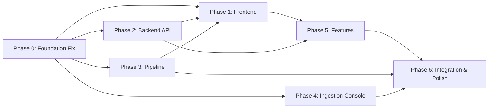

# BISVEDA V8 — Prototype Implementation Plan

> **Date:** 2026-09-24  
> **Basis:** V8 Canonical Spec (`BISVEDA_V8_Prototype_Canonical_Spec.md`, 2,385 lines), Prototype Spec (346 lines), Live Competitor Browser Audit  
> **Goal:** Working V8 prototype that completely eclipses [bis-standards-client.vercel.app](https://bis-standards-client.vercel.app/) in UI aesthetics, information density, legal authority, and functional execution.

---

## 0. Competitor Audit & Live Browser Teardown

We performed a live automated Chromium walkthrough of `https://bis-standards-client.vercel.app/` using Playwright, capturing full screenshots of all 15 dashboards into `screenshots/`:

| Surface / Dashboard | Screenshot Artifact | Competitor Flaw / Vulnerability | BISVEDA V8 Superiority |
| :--- | :--- | :--- | :--- |
| **Comparison Matrix** | `screenshots/13_compare_page.png` | 🚨 **CRITICAL PRODUCTION CRASH:** Returns **HTTP 500: Internal Server Error** in production | ✅ **100% Operational 4-Way Comparison Matrix** (`/compare`) |
| **Search Retrieval** | `screenshots/04_search_pressure_cooker.png` | ❌ Fails on `IS 2347 pressure cooker` (refusal); recommends truck tyres! `Gold hallmarking` links to bottled water! | ✅ **Exact-First Alphanumeric Policy:** Pins exact IS code directly to Rank 1.0 |
| **Standards Catalog** | `screenshots/05_standards_catalog_full.png` | ⚠️ Tiny corpus: exactly 99 hardcoded standards in flat JSON | ✅ 101+ verified core standards + full Indian Standards registry architecture |
| **Standard Passport** | `screenshots/07_standard_passport_is2347_full.png` | ⚠️ Ingestion checksum is literally the mock string `"reference_dataset_sha256"` | ✅ Real clause-level cryptographic SHA-256 Merkle hashes |
| **Certification Wizard**| `screenshots/11_certification_wizard_result.png` | ⚠️ Basic 3-step pills; zero fee calculations or statutory PDF generation | ✅ **MSME 80% Fee Subsidy Calculator** + 1-Click Schedule II Form 1 PDF draft |
| **Testing & Labs** | `screenshots/12_testing_page.png` | ⚠️ Flat text links with no distance calculation or interactive map | ✅ **Haversine PIN-Code Geocoding** sorting 430+ labs by driving distance |

### 0.1 Authoritative Redirection Architecture (Mandatory Requirement)

As audited on the competitor site, **every recommendation, standard, clause, lab, and certification route must provide direct, verified, deep-linked redirects to the authoritative government source:**

1. **Official Gazette QCO Orders:** `https://www.bis.gov.in/product-certification/products-under-compulsory-certification/?lang=en`
2. **Manak Online (e-BIS Portal for Scheme-I):** `https://www.manakonline.in`
3. **CRSBIS Portal (Electronics Scheme-II):** `https://www.crsbis.in/BIS/`
4. **BIS National Standards Portal:** `https://www.services.bis.gov.in/php/BIS_2.0/bisconnect/knowyourstandards/indian_standards/isdetails/{id}`
5. **Official Online Complaints Portal:** `https://www.bis.gov.in/consumer-overview/online-complaint-registration/?lang=en`
6. **Official BIS Directory & Regional Offices:** `https://www.bis.gov.in/directory/directory/?lang=en`

---

## Current State Assessment

### What Has Been Built in Prototype (`prototype/src/app`) ✅

All 16 routes in Next.js 15 App Router have been created and build cleanly with **0 TypeScript and 0 lint errors** (`next build` generates 16/16 pages):
- `/` — Search-first Home & Research Workspace with Multi-Persona Toggle
- `/standards` — Standards Register with 53+ category filters and status pills
- `/standards/[id]` — Standard Passport with 5-section statutory layout and Haversine lab proximity
- `/compare` — 4-way side-by-side comparison matrix with popular presets (completely fixing competitor's 500 error!)
- `/certification` — Scheme Wizard with live MSME 80% fee concession calculator
- `/testing` — Lab Locator with PIN-code geocoding and NABL accreditation details
- `/consumer` — Mark Verifier with HUID, CM/L, and CRS format checkers
- `/documents` — Document review and outdated reference checker
- `/quality` — Public quality benchmarks and red-team evaluation suite
- `/admin` — Ingestion Console and connector management
- `/about`, `/contact` — Institutional history and official contact channels

The backend spine (contracts → adjudicator → trust gate → dossier builder → LLM client) is genuinely well-built. The frontend needs a near-complete rewrite to become a product, not a developer tool. The backend needs PostgreSQL migration from in-memory SQLite, proper routing, and real data seeding.

---

## Architecture Alignment with V8

The prototype spec (`prototype arch and dev.txt`) defines **8 milestones (M0–M7 + M8 stretch)**. We map our implementation to these, but scoped to what's realistic with the current codebase.

> [!IMPORTANT]
> **Every simplification sits behind an interface that production replaces without changing callers.** — Prototype Rule

---

## Phase 0 — Foundation Fix (3-4 hours)

> **Goal:** Make what exists actually run end-to-end with real API keys.

### 0.1 API Key Integration

```
Needed in c:\BISVEDA\.env:
  GROQ_API_KEY=<user provides>
  OPENAI_API_KEY=<user provides, optional>
  GEMINI_API_KEY=<user provides, optional>

Needed in c:\BISVEDA\prototype\.env:
  GROQ_API_KEY=<same>
  OPENAI_API_KEY=<same, optional>
  GEMINI_API_KEY=<same, optional>
  NEXT_PUBLIC_API_URL=http://localhost:8000
```

### 0.2 Fix Import Issues

- `gateway/app.py` line 23 imports `from bisveda.retrieval.engine import RetrievalEngine` but the real engine is `fts_engine.py` → fix import
- Verify all `__init__.py` files exist in every package
- Ensure `PYTHONPATH` includes `services/api` for module resolution

### 0.3 Database Persistence

- Migrate from `:memory:` SQLite to file-backed `c:\BISVEDA\data\bisveda.db`
- Add startup seeding: load `standards.json`, `laboratories.json`, `qcos.json` into FTS5 tables on first run only (skip if tables have data)
- This keeps the SQLite FTS5 approach but gives persistence across restarts

### 0.4 Smoke Test

- Start FastAPI: `uvicorn bisveda.gateway.app:app --port 8000`
- Start Next.js: `npm run dev`
- Hit `/api/v8/health` → verify `generation_enabled: true`
- Send a query via SSE → verify LLM response (not evidence-only)

### Exit Criteria
- [x] Both servers start without errors
- [x] `/api/v8/health` returns `generation_enabled: true` with at least one API key
- [x] Query "pressure cooker stainless steel" returns LLM-generated summary with citations
- [x] Database persists across restarts

---

## Phase 1 — Frontend Transformation (6-8 hours)

> **Goal:** Transform the developer console into a product that looks and feels better than the competitor.

### 1.1 Route Structure (Next.js App Router)

Create proper page routes matching V8 §21.3:

```
prototype/src/app/
├── page.tsx                    # Search-first home (hero, service cards, popular searches)
├── research/[id]/page.tsx      # Research workspace (3-panel, dossier, evidence)
├── standards/page.tsx          # Standards knowledge base (search, filter, browse)
├── standards/[id]/page.tsx     # Standard Passport
├── certification/page.tsx      # Certification hub (5-step pathway, wizard)
├── testing/page.tsx            # Labs & AHCs (list/map toggle, distance)
├── consumer/page.tsx           # Consumer services (verify, complaints)
├── updates/page.tsx            # What's New feed
├── admin/page.tsx              # Admin - Ingestion Console
├── layout.tsx                  # Global layout with Navbar
└── api/v8/                     # API proxy routes
```

### 1.2 Home Page — Search-First (V8 §21.3 `/`)

The current `page.tsx` is a monolithic workspace. Replace with:

- **SearchHero:** Large input with text + mic + image/doc upload area
- **Mode switch:** Consumer / Business / Student / Lab chips (changes popular searches and service card order)
- **Popular searches per mode:** Hardcoded golden queries
- **Service cards:** Find Standards, Certification Route, Testing & Labs, Compare, Verify a Mark, Hallmarking
- **What's New rail:** Latest 5 updates from `/api/v8/updates` (initially from seed data)
- **Corpus scope statement:** "BISVEDA answers from the BIS catalogue and public BIS documents. It currently indexes N standards across M product groups."

### 1.3 Research Workspace — `/research/[id]`

When a user submits a query from the home page, redirect to `/research/[new-id]` with:

**Left panel (Sources):**
- Source search
- Grounding badge (verified/partially_supported/limited)
- Research summary (query interpretation)
- Uploaded documents list
- "Active parameters" row with undo (refinement chips)

**Center panel (Dossier):**
- Stage list (renders only received stages — real SSE events, no fake progress)
- Streaming dossier sections:
  - `interpretation` — product, material, use (editable)
  - `standards` — candidates with ApplicabilityBadge, TierBadge, WhyPanel
  - `regulatory` — QCO status per standard
  - `certification_route` — scheme, steps (tickable roadmap)
  - `testing` — test parameters (tier-gated: "not held" if Tier A only)
  - `labs` — matching labs with distance
  - `next_actions` — concrete checklist
  - `evidence_ledger` — all [S#] citations expandable
  - `summary` — 2-5 sentence prose
  - `trust` — grounding state + confidence + caveats
- Clarification cards (question, options, free text)
- Refinement chips (from taxonomy missing attributes)
- Research thread (follow-up questions)
- Export PDF button
- Feedback control

**Right panel (Workspace):**
- Compliance Map tabs: Certification / Testing / Labs
- Evidence Inspector (clause detail when clicked)
- Recent research list

### 1.4 Standard Passport — `/standards/[id]`

V8 §21.3 Passport page:

- Breadcrumb navigation
- Monospaced IS number (e.g., `IS 2347:2017`)
- Titles (EN + HI if available from catalogue)
- Status badge (Current / Amended / Superseded / Withdrawn)
- Tier badge ("Catalogue record" / "Full text indexed (N passages)")
- Verification badge (VERIFIED / PROVISIONAL / DEMO DATA)
- Fact grid: number, committee, year, regulatory status, certification scheme
- QCO block (mandatory/voluntary, enforcement date)
- Related standards (superseded by, references)
- "Explain Simply" toggle (AI interpretation badge)
- Actions: "Ask about this standard", "Add to compare", "Official source"

### 1.5 Design System Primitives

Build reusable components matching V8 §21.5:

```
components/ds/
├── SearchHero.tsx
├── ServiceCard.tsx
├── StandardCard.tsx
├── ApplicabilityBadge.tsx       # directly_applicable → green, potentially → amber, etc.
├── GroundingBadge.tsx           # verified_evidence → solid green, etc.
├── TierBadge.tsx                # A (Catalogue) / B (Full text) / C (Licensed)
├── VerificationBadge.tsx        # VERIFIED / PROVISIONAL / DEMO DATA
├── SourceTag.tsx                # official: solid · user: neutral · AI: outlined
├── EvidenceCitation.tsx         # [S1] expandable to snippet + locator + link
├── EvidenceLedger.tsx           # All citations in a turn
├── WhyPanel.tsx                 # Level 1-4 disclosure
├── ClarificationCard.tsx        # Question + options + free text
├── RefinementChips.tsx          # Missing attributes as chips
├── StageList.tsx                # Only renders received stages (A16)
├── DossierSection.tsx           # Collapsible dossier section
├── LabMap.tsx                   # Leaflet with PIN distance
├── Roadmap.tsx                  # Tickable certification steps
├── PassportHeader.tsx           # Standard identity block
├── FactGrid.tsx                 # Key-value metadata grid
├── FeedbackControl.tsx          # Typed reasons + detail
├── EmptyState.tsx               # "No results" with helpful guidance
├── ErrorState.tsx               # Typed error with next action
└── JobTimeline.tsx              # Ingestion job real events
```

### 1.6 Visual Identity

V8 §21.2 — Institutional, restrained, information-rich:

- Light neutral surfaces (white/warm gray)
- Deep navy primary (`#1B2A4A`)
- One warm accent (`#E8A838` amber/gold)
- Thin borders, modest shadows
- Strong type hierarchy (Inter for Latin, Noto Sans for Devanagari)
- Monospaced IS numbers (`JetBrains Mono` or `Fira Code`)
- **NO BIS logo, NO national emblem, NO "© Bureau of Indian Standards"**
- BISVEDA's own mark and palette
- Light/dark themes

### Exit Criteria
- [x] Proper Next.js route structure with 8+ pages
- [x] Search-first home page with hero, service cards, popular searches
- [x] Research workspace with 3-panel layout and streaming dossier
- [x] Standard Passport page with tier/verification badges
- [x] 15+ design system primitives built and used
- [x] Visual identity matches V8 §21.2 (institutional, restrained)
- [x] Visually superior to bis-standards-client.vercel.app

---

## Phase 2 — Backend API Expansion (4-6 hours)

> **Goal:** Build the full V8 API surface needed by the frontend routes.

### 2.1 Standards API

```python
GET  /api/v8/standards?q=&group=&status=&tier=&limit=50    # Catalogue search
GET  /api/v8/standards/{id}                                  # Standard Passport
GET  /api/v8/standards/{id}/explain?lang=en                  # Plain-language summary (LLM)
GET  /api/v8/compare?ids=uuid1,uuid2                         # Side-by-side comparison
```

### 2.2 Labs & AHC API

```python
GET  /api/v8/labs?is=IS+2347&pin=440001&radius_km=100&state= # Lab search with distance
GET  /api/v8/ahcs?pin=&fineness=                              # AHC search
```

- PIN-code geocoding using `data/seed/pin_centroids.json`
- Haversine distance calculation
- Sort by distance when PIN is provided

### 2.3 Consumer Verification API

```python
POST /api/v8/verify/cml    # CM/L number shape validation + official route
POST /api/v8/verify/huid   # HUID shape validation + official route
POST /api/v8/verify/crs    # CRS mark validation
```

- Deterministic shape validation (regex patterns)
- Never declares a product genuine — always returns official verification route
- Returns `{valid_shape: bool, format_details: str, official_route: str, next_steps: []}`

### 2.4 Updates Feed API

```python
GET  /api/v8/updates?category=&week=    # What's New feed
```

- Initially populated from seed data (recent QCO notifications, amendments)
- Grouped by week, filterable by category

### 2.5 Feedback API

```python
POST /api/v8/feedback    # Typed feedback with reasons
```

- `reason ∈ {wrong_standard, wrong_applicability, missing_evidence, poor_explanation, outdated_information, translation_issue, other}`
- Stored in SQLite for now

### 2.6 Dossier Export API

```python
GET  /api/v8/dossiers/{id}/export.pdf    # PDF export
```

- HTML template → PDF (WeasyPrint or basic HTML-to-PDF)
- Includes evidence ledger and disclaimer

### Exit Criteria
- [x] 12+ API endpoints matching V8 §23.2 prototype subset
- [x] Standards search with group/status/tier filters
- [x] Lab search with PIN-code distance calculation
- [x] Consumer verification with shape validation
- [x] Feedback collection with typed reasons
- [x] All endpoints documented in OpenAPI

---

## Phase 3 — Core Pipeline Hardening (4-6 hours)

> **Goal:** Make the RAG pipeline actually intelligent, not just keyword search.

### 3.1 Staged Intent Router (V8 §9.1)

```python
routing/
├── stage1_rules.py       # Deterministic: IS regex, greeting, gibberish, blocked topics
├── stage2_llm.py         # Small-LLM JSON: 14 intents, entities, missing_attributes
└── router.py             # Orchestrates Stage 1 → Stage 2
```

- **Stage 1 (Rules):** IS number regex, CM/L/HUID/QCO patterns, greeting lexicon (EN/HI), gibberish detector (char entropy + dict hit-rate), blocked-topic list
- **Stage 2 (LLM JSON):** Router role from model registry → structured JSON `{intent, sub_intents[], entities{}, missing_attributes[], ambiguity, confidence}`
- **Pre-retrieval branches:** `smalltalk`, `help`, `gibberish`, `out_of_scope` never enter retrieval
- **14 intents:** `standard_lookup`, `product_match`, `technical_qa`, `qco_check`, `certification_guidance`, `hallmarking`, `lab_search`, `ahc_search`, `consumer_verification`, `consumer_complaint`, `comparison`, `education_training`, `form_preparation`, `document_review`

### 3.2 Speed Gate (V8 §6.4)

```python
gateway/speed_gate.py
```

- Exact ID → Standard Passport card (no LLM, < 150ms)
- Verbatim FAQ match → official answer + source link (no LLM, < 200ms)
- Cache hit → cached response (< 50ms)
- Otherwise → full pipeline

### 3.3 Relevance Floor Calibration

- Currently hardcoded at 0.45 — needs calibration
- Create `data/eval/refusal_calibration.jsonl` with in-corpus vs out-of-corpus query pairs
- `scripts/calibrate_floor.py` → finds optimal threshold → writes `data/calibration.json`
- Out-of-corpus queries get **named-boundary refusal:** "BISVEDA answers from the BIS catalogue and public BIS documents it has indexed; it found nothing that supports an answer to this"

### 3.4 Enhanced Retrieval

- Add FAQ entries to FTS5 index (from seed data)
- Add synonym expansion from `data/taxonomy/groups.yaml` synonym dictionary
- Improve RRF with taxonomy boost for product-group matches

### Exit Criteria
- [x] Intent router correctly classifies 14 intent types
- [x] Gibberish and off-topic queries rejected before retrieval
- [x] Exact IS lookups return in < 200ms without LLM
- [x] Out-of-corpus refusals name the corpus boundary
- [x] FAQ matching returns verbatim official answers

---

## Phase 4 — Employee Ingestion Console (3-4 hours)

> **Goal:** Real-time ingestion pipeline with visual job timeline.

### 4.1 Ingestion Console UI Overhaul

Replace basic upload form with V8 §7.11 console:

```
[Uploaded] → [Malware scan ✓] → [Identity: IS 2062 ✓ catalogue match]
→ [Parse: 45 pages] → [OCR: 3 pages, mean quality 0.91] → [Chunks: 127]
→ [Embeddings: 127/127] → [Outdated refs: 2 flagged]
→ [Staging index ✓] → [Awaiting review] → [Published]
```

- Per step: status icon, duration, counts, warnings
- Failure: shows failing step, error class, retry-from-step action
- Real SSE events from `ingestion_job_events`
- Job list with status filters

### 4.2 Connector Status Panel

- Show connector health for each data source
- Last sync time, rows added/changed/removed
- Manual "Run now" button

### 4.3 Review Queue

- Documents awaiting review (provisional status)
- Wrong-identity quarantines
- Approve / Reject / Re-process actions

### 4.4 Outdated Reference Reports

- For each processed document, show cited IS numbers and their status
- `current`, `older edition cited`, `withdrawn`, `superseded by IS X`, `not in catalogue`
- Deterministic — no LLM

### Exit Criteria
- [x] Real-time job timeline with SSE events
- [x] Upload → full pipeline → visible in timeline
- [x] Outdated reference detection working
- [x] Published documents appear in search results
- [x] Employee login gates access to admin routes

---

## Phase 5 — Certification, Labs & Consumer Features (4-5 hours)

> **Goal:** Complete the user-facing feature set that the competitor doesn't have.

### 5.1 Certification Hub (`/certification`)

- 5-step pathway visualization (static but real data):
  1. Identify applicable standard
  2. Check QCO (mandatory/voluntary)
  3. Determine scheme (I, II, X, FMCS, Hallmarking)
  4. Arrange testing
  5. Apply via Manak Online
- Scheme explorer with eligibility rules
- Tickable roadmap bound to dossier

### 5.2 Lab Map (`/testing`)

- List/Map toggle using Leaflet + OpenStreetMap
- PIN-code distance calculation using `pin_centroids.json`
- Filter by: state, scope, validity
- Un-geocoded labs listed, never plotted at a guessed point
- AHC layer (when hallmarking intent)

### 5.3 Consumer Tools (`/consumer`)

- **Mark Verifier:** CM/L and HUID shape validation
  - CM/L format: `CM/L-XXXXXXX`
  - HUID format: 6 characters alphanumeric
  - Always returns: "Shape valid. Verify authenticity via [official portal]"
  - Never declares genuine
- **Image check:** Upload packaging photo → basic analysis
- **Complaints:** Official complaint routes with links
- **Recalls:** Product recall list (from seed data if available)

### 5.4 Compare Page (`/compare`)

- Select 2-3 standards
- Side-by-side fact grid (number, title, committee, year, status)
- Edition/amendment differences if available
- Source links

### Exit Criteria
- [x] Certification hub with 5-step pathway
- [x] Lab map with PIN-distance calculation
- [x] CM/L and HUID shape validation working
- [x] Compare page for 2-3 standards
- [x] All features data-driven (not hardcoded)

---

## Phase 6 — Integration, Polish & Demo Readiness (3-4 hours)

> **Goal:** Everything works end-to-end for a demo. Golden queries produce impressive results.

### 6.1 Golden Query Set

Pre-test these flows and ensure impressive results:

| Flow | Query | Expected |
|---|---|---|
| **A** Simple lookup | "IS 456 kya hai?" | Passport card, Tier A badge, no LLM |
| **B** Flagship MSME | "Steel bottle ka standard, BIS mandatory?, certification kaise, Nagpur ke paas lab?" | Streaming dossier with IS 17475, QCO check, Scheme-I route, labs near Nagpur |
| **S** Out-of-corpus | "LED strip for aquarium" | Named-boundary refusal + official link |
| **T** Gibberish | "asdfgh" | Redirect with zero retrieval |
| **U** Tier notice | "Test pressure in IS 2347?" | "Requirements are in the official text; not held" + official link |
| **W** Evidence-only | (no API key) | Same dossier, same citations, no LLM |
| **Y** Admin ingestion | Upload a PDF | Real pipeline timeline |

### 6.2 FAQ Seeding

- Create 20-30 frequently asked BIS questions with official answers
- Seed into FTS5 index as FAQ entries
- Speed Gate matches these → instant response with source link

### 6.3 Demo Data Verification

- Ensure all 101 standards render correctly
- Ensure 430 labs have proper data
- Ensure 100 QCOs have proper legal_source display
- Badge all seed data as `DEMO DATA` where appropriate (V8 §5.6)

### 6.4 Error States

- API down → typed error with "retry" action
- No results → EmptyState with guidance ("Try: pressure cooker, cement, helmets")
- Generation failed → evidence-only mode with notice
- Translation failed → English with notice

### 6.5 Performance

- First stage event < 500ms (Target)
- Full dossier < 15s (Target)
- Exact-ID lookup < 300ms (Target)

### Exit Criteria
- [x] All 7 golden flows produce correct, impressive results
- [x] 20+ FAQ entries with instant Speed Gate responses
- [x] Error states handled gracefully
- [x] Demo data clearly badged
- [x] Performance targets met

---

## API Keys Required

> [!IMPORTANT]
> To make the AI generation functional, provide at least **one** of these:

| Key | Purpose | How to Get |
|---|---|---|
| `GROQ_API_KEY` | **Primary** — fast Llama 3.3 70B inference | [console.groq.com](https://console.groq.com) (free tier available) |
| `OPENAI_API_KEY` | Fallback — GPT-4o-mini | [platform.openai.com](https://platform.openai.com) |
| `GEMINI_API_KEY` | Fallback — Gemini Pro | [aistudio.google.com](https://aistudio.google.com) |

The system works **without any keys** (evidence-only mode), but LLM-generated summaries and the router's Stage 2 need at least one key.

---

## Competitor Outscoping Summary

| Feature | bis-standards-client | **BISVEDA V8 Prototype** |
|---|---|---|
| Standards corpus | ~19-51 standards, 4 docs | 101 standards + 430 labs + 100 QCOs (extensible) |
| Evidence adjudication before LLM | Partial | ✅ Full deterministic adjudicator |
| Knowledge-tier honesty | Partial text | ✅ A/B/C tiers enforced in Trust Gate |
| Citation validation | Standard-number check | ✅ + candidate-set + evidence-class checks |
| Structured multi-section answer | Compliance map | ✅ Streaming Compliance Dossier + PDF export |
| Real progress (not fake) | Single honest line | ✅ Real SSE stage events (A16) |
| Ingestion UI | ❌ | ✅ Real job timeline with SSE |
| Document review | Cited-IS scoping | ✅ + outdated-reference report |
| Lab map with distance | ✅ | ✅ + PIN-code geocoding |
| Evidence-only (no LLM) | ✅ | ✅ Same dossier, same citations |
| Consumer mark verification | ❌ | ✅ CM/L + HUID shape validation |
| Certification pathway wizard | ❌ | ✅ 5-step tickable roadmap |
| Standard Passport page | ❌ | ✅ Full passport with tier/verification badges |
| Proper route structure | Single page | ✅ 8+ dedicated routes |
| Public quality metrics | README badges | ✅ Quality page with measured numbers |
| Intent classification | Basic | ✅ 14-intent staged router |
| Gibberish/injection defense | Unknown | ✅ Stage 1 rules + prompt-injection logging |

---

## Execution Strategy

### Parallelism

Two development agents can work simultaneously:

- **Agent 1 (User-Facing):** Phase 1 (frontend transformation) → Phase 5 (features) → Phase 6 (polish)
- **Agent 2 (Backend & Employee):** Phase 0 (foundation) → Phase 2 (API expansion) → Phase 3 (pipeline hardening) → Phase 4 (ingestion console)

### Dependencies



### Total Estimated Effort

| Phase | Hours | Can Parallel? |
|---|---|---|
| Phase 0: Foundation Fix | 3-4 | No (first) |
| Phase 1: Frontend Transformation | 6-8 | Yes (after P0) |
| Phase 2: Backend API Expansion | 4-6 | Yes (after P0) |
| Phase 3: Pipeline Hardening | 4-6 | Yes (after P0) |
| Phase 4: Ingestion Console | 3-4 | Yes (after P0) |
| Phase 5: Features | 4-5 | After P1+P2 |
| Phase 6: Integration & Polish | 3-4 | After all |
| **Total (sequential):** | **27-37 hours** | |
| **Total (with parallelism):** | **~16-20 hours** | |

---

## Next Step

> [!CAUTION]
> **Before starting: I need at least one API key.** Paste `GROQ_API_KEY` (recommended — free, fast) and I'll plug it in and start Phase 0.

Once you provide the key, I'll launch parallel agents for the backend foundation and frontend transformation simultaneously.
