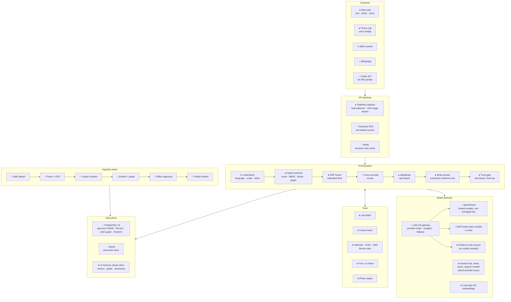

<div align="center">


# BISVEDA

**An assistant for Indian Standards and BIS services that cites the exact clause and page for every answer.**

Smart India Hackathon 2026 · Problem Statement **SIH26107** · Ministry of Consumer Affairs, Food & Public Distribution


[Why BISVEDA](#what-makes-bisveda-different) · [Architecture](#platform-architecture) · [How an answer is made](#how-an-answer-is-made) · [Trust](#trust-by-design) · [Ingestion and scale](#knowledge-ingestion-scale-and-deployment) · [Prototype](#prototype-running-today) · [Roadmap](#roadmap) · [Getting started](#getting-started)

</div>

---

Citizens, jewellers and small manufacturers ask BIS the same questions every day. Which standard covers my product? Where can I get it tested? What does 916 on my chain mean? How do I register my shop for hallmarking? The answers exist, but they are spread across standards PDFs, lab portals, directories and application forms.

BISVEDA answers these questions in plain language and in the user's own language, by text, photo, voice or phone call. Every answer carries `[S1]`-style source tags that open the exact clause and page of the official document. When the documents don't support an answer, BISVEDA says so and points to the right BIS service instead of guessing.

> [!IMPORTANT]
> **Designed as a platform for the whole BIS catalogue.** BISVEDA is a layered, stateless, interface-driven system: channels, gateway, orchestration, tools, a governed ingestion plane and a replaceable data plane. The prototype in this repository already runs the full answer path end to end on a curated set of official BIS documents. The next build phase turns on live document ingestion and the Postgres-backed hybrid retrieval plane behind interfaces the prototype already uses, so growth means ingesting documents and adding infrastructure, not rewriting the system.

## What makes BISVEDA different

| | Typical assistant | BISVEDA |
|---|---|---|
| **Accuracy** | "Zero hallucination" claimed | Measured: 0 wrong standards, 100% of source tags valid, 100% of figures supported by the cited clause |
| **Not in the documents** | Falls back to the model's general knowledge | Says so, and links the official catalogue or helpline |
| **HUID and licence** | Claims to verify | Format check, plus the BIS Care / Manak Online route that can confirm it |
| **Languages** | Machine translation after the fact | Answers are written in the user's language from English evidence; IS numbers and source tags are protected and re-checked |
| **BIS staff** | Chat only | A console to see and control the knowledge the assistant answers from |

### Features

| | What the user gets | Where the facts come from |
|---|---|---|
| **Cited answers** | Plain-language answers with `[S#]` tags; one click opens the clause text and the PDF at that page | Official standard PDFs |
| **Product to standard** | Describe a product ("battery-operated toy car") and get every applicable standard, each with what it covers | Each standard's own scope clause |
| **Hallmark and mark check** | Purity decoding (916 → 22 carat per IS 1417), the marks a hallmarked article must carry, and a **format** check of a HUID or CM/L number with the BIS Care / Manak Online route | IS 1417 clauses + deterministic format rules |
| **Photo inspection** | Upload a product or jewellery photo; BISVEDA reads the category, label text, ISI mark, licence number, purity mark and HUID | Vision model, shown as "what we read from your photo", never cited as a BIS source |
| **Testing labs** | BIS-recognised labs that have the user's standard in scope, on a map, nearest first | BIS LIMS directory |
| **Hallmarking centres** | Operative Assaying and Hallmarking Centres near a city or the user's location | Manak Online directory |
| **Form I for jewellers** | Details given in one message in any language, checked with follow-up questions (such as a missing PIN code), delivered as an **editable Word draft in the official Form I layout** | The Form I PDF |
| **Multilingual** | Ask in English, Hindi, Hinglish, Marathi, Tamil, Telugu, Bengali, Kannada, Malayalam or Gujarati, in native or Roman script | Language detection + English working query + guarded translation |
| **Page translation** | One language picker translates the whole interface, and answers follow the chosen language | Batched UI translation |
| **Voice and phone** | Speak instead of typing, hear answers read aloud, or request a phone call and talk to BISVEDA | Speech-to-text, browser read-aloud, telephony voice bridge |
| **Staff console** (`/admin`) | Knowledge graph explorer, edition and amendment register per standard, document and clause browser, lab and centre directories, plus showcase interfaces for ingestion and revision registration | The same knowledge base the chat uses |

BISVEDA **never declares a mark, licence or HUID valid or genuine**. It checks the format and sends the user to BIS Care or Manak Online, the only services that can confirm it.

## Platform architecture

A modular monolith behind interfaces: every component sits behind a small contract, so production infrastructure replaces the prototype's implementation without changing its callers.

`●` running in the prototype · `○` production design, next build phase

| | Working in the prototype | Next build phase |
|---|---|---|
| **Answer path** | Understand, hybrid retrieval (exact, BM25, dense, graph), RRF, adjudication, answer writing, trust gate, streamed over SSE | Cross-encoder reranking and the model provider chain |
| **Knowledge** | 8 standards and Form I plus the official lab and centre directories, built from the PDFs with one command and loaded in memory | Live staff ingestion with officer approval into PostgreSQL + pgvector |
| **Channels** | Web chat, phone bridge, staff console | WhatsApp and a public API for BIS portals |



| Layer | Production design | Running today | Interface that stays the same |
|---|---|---|---|
| **Channels** | Web, phone, staff console, WhatsApp, public API | Web chat (text, photo, voice, read-aloud, page translation), phone call bridge, staff console | `POST /api/chat` SSE contract |
| **Gateway** | Replicas behind a load balancer, Keycloak SSO and role-based access, Redis sessions and cache | Next.js API routes; conversation state travels with each request | `stage`, `response`, `error` events |
| **Understanding** | Language and script detection, English working query, intent; Bhashini speech and translation with a local fallback | Hosted fast model, Whisper speech-to-text, rule-based fallback router | `understandTurn` |
| **Retrieval** | pgvector HNSW (dense), Postgres full-text and trigram (sparse), Apache AGE (graph), exact IS-number lookup, RRF, bge-reranker-v2-m3 cross-encoder | In-memory exact + BM25 + bge-m3 dense + graph, RRF (k = 60), calibrated floor | `pipeline/retrieve.ts` |
| **Adjudication** | Rule-based applicability with knowledge tiers: **A** catalogue metadata, **B** public official text, **C** full clause text, each limiting what may be claimed from that source | Rule-based choice of the applicable standard from its own scope clause | `pipeline/adjudicate.ts` |
| **Generation** | LiteLLM gateway with an ordered chain: hosted models through OpenRouter (one managed key), then self-hosted open models in India, then evidence-only | Hosted model with keys in env, and an evidence-only fallback | `pipeline/answer.ts` |
| **Trust gate** | Same code in production and in the prototype | Same code | `pipeline/trust.ts` |
| **Geo tools** | PostGIS nearest-lab and nearest-centre queries | Haversine distance over the loaded directories | `lib/tools/*` |
| **Data** | PostgreSQL 16 with pgvector holding vectors beside the relational data (no separate vector service), MinIO, Redis | JSON knowledge base loaded once into memory | `lib/kb/store.ts` |
| **Ingestion** | Temporal workflows with officer approval and an audit log | `npm run kb:build` and throttled directory scrapers | `scripts/kb/*` |

## How an answer is made

`POST /api/chat` streams Server-Sent Events. The UI shows a stage ("Understanding your question", "Searching official BIS documents", "Checking the evidence", "Writing the answer") only when that stage actually runs.

| Step | File | What it does |
|---|---|---|
| Understand | `pipeline/understand.ts` | Detects language and script, writes an English working query, resolves follow-ups ("what test does *it* need?"), and classifies intent. If the model is unavailable, a rule-based router still handles directories, mark checks, Form I and off-topic questions. |
| Verified FAQs | `pipeline/speedgate.ts` | Instant answers for common questions, served only when marked verified against real clauses |
| Tools | `lib/tools/*` | Lab and centre lookups with distance sorting, hallmark / HUID / CM/L format rules, Form I extraction and validation, Word file generation |
| Retrieve | `pipeline/retrieve.ts` | Four retrievers together: **exact** (an IS number pins its standard), **BM25**, **dense** (bge-m3 cosine) and **graph** (keeps follow-ups on the same standard) |
| Fuse and floor | `pipeline/fuse.ts`, `floor.ts` | Reciprocal Rank Fusion (k = 60), then a relevance floor calibrated on the golden set; below it, the question is treated as outside the documents |
| Adjudicate | `pipeline/adjudicate.ts`, `package.ts` | Rule-based choice of the applicable standard from its own scope clause; evidence numbered `[S1]`, `[S2]`, … each tied to a real clause and page |
| Write | `pipeline/answer.ts` | The model sees only the numbered evidence and must tag every fact. If it is unavailable, an evidence-only answer is returned. |
| Trust gate | `pipeline/trust.ts` | **Rule-based, with the final say.** It checks sentence by sentence, removes source tags that don't exist, drops any sentence whose figure or IS number isn't in its cited clause, and refuses if nothing sourced survives |

## Trust by design

1. **The model never decides what is true.** Standard selection, relevance, format checks and the final gate are plain code. The model only phrases evidence it was given.
2. **Numbers are checked, not trusted.** Every figure must appear in the clause it cites, in any script.
3. **"Not in our documents" is a real answer,** with a link to the BIS Standards Catalogue or the consumer helpline.
4. **User evidence stays separate.** Photo readings can trigger a check but can never become a `[S#]` source.
5. **Degrades gracefully.** Without the language model, directories, mark checks, Form I and evidence-only answers keep working, and off-topic questions are still refused.

## Knowledge, ingestion, scale and deployment

### Ingestion plane

New and amended standards enter through a governed workflow, never by editing the live index:

`staff upload → MinIO → Temporal workflow (parse + OCR, chunk by clause, embed, link graph) → officer approval → published edition`

The prototype already runs every processing step (parse, clause chunking, embedding, graph linking) as a repeatable build over the uploaded PDFs, and the staff console carries the workflow interface. Connecting the two behind an approval step is the next build phase.

Every answer names the edition it used, and the staff console shows the edition and amendment register for each standard. Knowledge tiers decide how much may be claimed from a source: catalogue metadata supports identity and scope only, public official text supports paragraph citations, and full clause text supports clause-level citations with figures.

### Resilience

- **Provider chain ending in no model at all.** Hosted model, then self-hosted open-weight model in India, then an evidence-only answer rendered straight from the adjudicated evidence.
- **Deterministic core.** Routing rules, adjudication, format checks and the trust gate are plain code, so safety does not depend on a model provider being up.
- **Evaluation built in.** Golden and multilingual test sets plus a calibrated relevance floor let coverage grow without silent drops in accuracy.

### Scale

- **Stateless API.** Conversation state travels with each request, so identical replicas run behind any load balancer.
- **One retrieval interface.** `pipeline/retrieve.ts` hides where chunks and vectors live. Moving from the in-memory store to Postgres + pgvector changes the store, not the pipeline.
- **Local embeddings.** bge-m3 runs in-process with no per-call cost or quota, and can move to a separate batched embedding service.
- **Config-driven models.** Every model id comes from env, so providers can be changed, added or self-hosted without code changes; in production a LiteLLM gateway sits in front of every provider, with OpenRouter as the hosted tier and one managed key.

| Growth step | What changes | What it unlocks |
|---|---|---|
| Up to ~150 standards | Nothing; ingest the PDFs | In-memory store, brute-force search still fast |
| Whole BIS catalogue | Postgres + pgvector (HNSW) + full-text search behind the existing retrieval interface | Millions of clauses |
| High traffic | More web replicas; embedding service split out | Throughput limited by budget, not code |
| Staff-driven updates | Staff upload wired to the build pipeline through Temporal, with officer approval | New editions and amendments go live without a developer |
| Accounts and history | Keycloak SSO and server-side sessions in Redis | Cross-device history and per-user audit |

### Deployment modes

`○` Demo · Cloud · NIC government cloud (MeghRaj) with language models served from India · Air-gapped

### Service targets

| Target | Goal |
|---|---|
| Exact-ID and FAQ fast path | < 200 ms (p95) |
| First stage event | < 300 ms (p95) |
| Full answer | < 10 s (p95) |
| Source tags valid after the trust gate | 100% |
| Wrong standard on the golden set | 0 |
| Product-to-standard recall@5 | ≥ 0.92 |
| Accessibility | WCAG 2.1 AA |

## Prototype: running today

The prototype runs the full request path end to end: understanding, hybrid retrieval, adjudication, answer writing and the trust gate, plus the lab and centre finders, mark checks, photo reading, Form I drafting, voice and the staff console. It answers from 8 Indian Standards and Form I (IS 4151, IS 2925, IS 9873 Part 1 and Part 3, IS 15644, IS 1417, IS 1418, IS 15820), the official BIS LIMS lab directory and the Manak Online centre directory. The editions are exactly those in the uploaded PDFs, for example IS 1417 : 1999 with Amendments 1 to 3.

The prototype holds **760 clause-level chunks** with 1024-dim bge-m3 vectors, a knowledge graph of **320 nodes and 343 links**, **29 testing labs** with these standards in scope, and **1,651 hallmarking centres** (1,512 operative; 1,490 on the map, the rest listed without a pin rather than guessed).

**Measured (2026-09-29)**, `npm run eval:rag` and `npm run eval:multi`:

| Metric | Result |
|---|---|
| Wrong standard given as the main answer | **0** |
| Source tags that resolve to a real clause | **65 / 65** |
| Figures supported by the cited clause | **80 / 80** |
| Correct kind of reply (answer, clarify, refusal) | **32 / 32** |
| Golden set | **31 / 32** |
| Multilingual set, 9 languages in native and Roman script | **23 / 24** |

Per-case results are in `prototype/data/eval/results/`.

> [!NOTE]
> **Showcase interfaces.** To show the intended staff and caller experience, a few parts of the prototype are interface showcases: the staff console's document ingestion and revision/amendment registration screens, and the phone channel's call experience. They demonstrate the workflow and the design; connecting them to the live knowledge base (approval-gated ingestion, and phone answers cited from the same evidence) is the next build phase.

## Roadmap

**Next build phase: a working ingestion layer and full-scale hybrid retrieval, on the interfaces the prototype already uses.**

- **Governed ingestion:** staff upload runs the existing parse, chunk, embed and graph steps, then an officer approves before any edition goes live, with an audit log.
- **PostgreSQL 16 data plane:** pgvector, full-text search, Apache AGE and PostGIS behind the existing store interface.
- **Cross-encoder reranking:** bge-reranker-v2-m3 between fusion and adjudication.
- **Model gateway:** LiteLLM in front of OpenRouter (managed keys, hosted fallback), self-hosted open models in India and the evidence-only tier, so an outage never takes answers offline.
- **Phone agent on the same knowledge base:** route calls through retrieval and the trust gate, and carry the web conversation into the call.
- **WhatsApp channel and public API** for BIS portals.
- **Full standards catalogue and certification schemes:** titles, scopes and scheme guides for every standard BIS provides.
- **Official verification links:** HUID and licence status through BIS APIs if they become available.
- **Government cloud deployment:** NIC MeghRaj hosting with language models served from India.

## Getting started

### Prerequisites

- Node.js 20+ and npm
- A **Groq API key** (chat, intent, speech-to-text) and a **Gemini API key** (photo reading)
- Optional, only to rebuild the knowledge base: Python 3 with `pymupdf` and `rapidocr_onnxruntime` (the built knowledge base is committed)

### Run the web app

```bash
cd prototype
npm install
cp .env.example .env   # add GROQ_API_KEY and GEMINI_API_KEY
npm run dev            # http://localhost:3000
```

On first use, the bge-m3 model downloads once from the Hugging Face Hub and is cached locally.

Optional `.env` settings: `ADMIN_PASSWORD` for `/admin`, and model overrides `GROQ_CHAT_MODEL`, `GROQ_FAST_MODEL`, `GROQ_STT_MODEL`, `GEMINI_VISION_MODEL`, `EMBED_MODEL`.

> [!TIP]
> `python scripts/boot.py` (or `boot.ps1` / `boot.bat`) from the repo root starts the web app and the phone voice bridge together. The bridge needs Python (`fastapi`, `uvicorn`, `pyngrok`, `google-genai`) plus telephony and ngrok credentials. For a web-only run, `npm run dev` is enough.

### Scripts (run from `prototype/`)

| Command | Purpose |
|---|---|
| `npm run dev` · `npm run build` · `npm run typecheck` | Develop, build, type-check |
| `npm run kb:build` | Rebuild `data/kb/*` from the PDFs |
| `npm run calibrate:floor` | Recompute the relevance floor from the golden set |
| `npm run dir:labs` · `npm run dir:ahc` | Refresh the lab and centre directories (throttled, cached) |
| `npm run eval:rag` | Golden-set evaluation |
| `npm run eval:multi` | Multilingual evaluation (`-- --only id1,id2` for specific cases) |

## Repository layout

```text
BISVEDA/
├── example docs uploaded by employees/   # source PDFs
├── docs/                                 # demo guide, decisions, product requirements
├── scripts/                              # boot supervisor, phone voice bridge (Python)
└── prototype/                            # the Next.js app
    ├── data/
    │   ├── kb/                           # chunks, standards, graph, calibration, Form I schema
    │   ├── directory/                    # labs (LIMS), hallmarking centres (Manak Online)
    │   └── eval/                         # golden + multilingual sets, results
    ├── scripts/
    │   ├── kb/                           # parse, chunk, embed, graph, build
    │   └── directory/                    # LIMS and Manak Online scrapers
    └── src/
        ├── app/                          # pages (/, /chat, /admin, /labs, /standards, /form-i/print) + API routes
        ├── components/                   # chat cards, staff console, accessibility
        └── lib/
            ├── pipeline/                 # understand, retrieve, fuse, floor, adjudicate, answer, trust, orchestrator
            ├── tools/                    # labs, centres, hallmark, Form I (+ Word export)
            ├── kb/                       # in-memory store, BM25 + dense search
            ├── ui-i18n/                  # interface translation
            ├── voice/                    # speech input, read-aloud
            └── vision.ts                 # photo reading
```

## Tech stack

**Production design:** PostgreSQL 16 (pgvector, full-text, Apache AGE, PostGIS) · MinIO · Redis · Temporal · Keycloak · LiteLLM · OpenRouter · bge-reranker-v2-m3 · Bhashini · NIC MeghRaj.
**Prototype:** Next.js 15, React 19, TypeScript, Tailwind CSS v4, Leaflet maps, react-force-graph, docx · Groq-hosted open models (answers, intent, Whisper speech-to-text), Gemini (photo reading), bge-m3 via transformers.js (local embeddings) · Python + PyMuPDF + OCR and tsx build scripts for the offline pipeline · JSON knowledge base loaded into memory.
