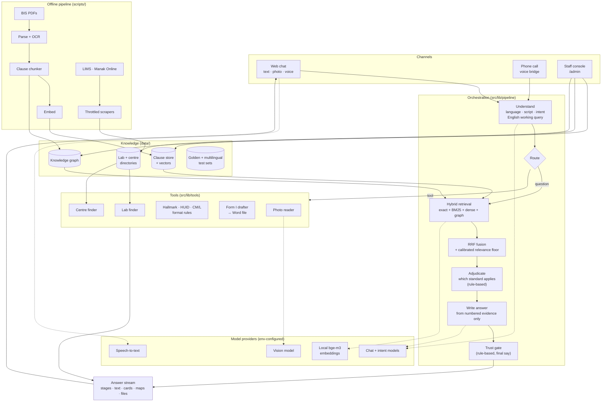

<div align="center">


# BISVEDA

**An assistant for Indian Standards and BIS services that cites the exact clause and page for every answer.**

Smart India Hackathon 2026 · Problem Statement **SIH26107** · Ministry of Consumer Affairs, Food & Public Distribution


[Features](#features) · [Architecture](#architecture) · [How an answer is made](#how-an-answer-is-made) · [Quality](#measured-quality) · [Scaling](#built-to-scale) · [Roadmap](#roadmap) · [Getting started](#getting-started)

</div>

---

Citizens, jewellers and small manufacturers ask BIS the same questions every day. Which standard covers my product? Where can I get it tested? What does 916 on my chain mean? How do I register my shop for hallmarking? The answers exist, but they are spread across standards PDFs, lab portals, directories and application forms.

BISVEDA answers these questions in plain language and in the user's own language, by text, photo, voice or phone call. Every answer carries `[S1]`-style source tags that open the exact clause and page of the official document. When the documents don't support an answer, BISVEDA says so and points to the right BIS service instead of guessing.

> [!IMPORTANT]
> **The foundation is complete and built to scale.** Every layer of the full system already exists: channels, understanding, tools, hybrid retrieval, deterministic checks, the knowledge base and the staff console. It runs today on 8 Indian Standards, Form I, and the official lab and hallmarking-centre directories. Adding more standards means ingesting documents, not rewriting the system. See [Built to scale](#built-to-scale).

## Features

| | What the user gets | Where the facts come from |
|---|---|---|
| **Cited answers** | Plain-language answers with `[S#]` tags; one click opens the clause text and the PDF at that page | Official standard PDFs |
| **Product to standard** | Describe a product ("battery-operated toy car") and get every applicable standard, each with what it covers | Each standard's own scope clause |
| **Hallmark and mark check** | Purity decoding (916 → 22 carat per IS 1417), the marks a hallmarked article must carry, and a **format** check of a HUID or CM/L number with the BIS Care / Manak Online route | IS 1417 clauses + deterministic format rules |
| **Photo inspection** | Upload a product or jewellery photo; BISVEDA reads the category, label text, ISI mark, licence number, purity mark and HUID | Vision model, shown as "what we read from your photo", never cited as a BIS source |
| **Testing labs** | BIS-recognised labs that have the user's standard in scope, on a map, nearest first | BIS LIMS directory |
| **Hallmarking centres** | Operative Assaying and Hallmarking Centres near a city or the user's location | Manak Online directory |
| **Form I for jewellers** | Details given in one message in any language, checked with follow-up questions (such as a missing PIN code), delivered as an **editable Word draft in the official Form I layout** | The Form I PDF |
| **Multilingual** | Ask in English, Hindi, Hinglish, Marathi, Tamil, Telugu, Bengali, Kannada, Malayalam or Gujarati, in native or Roman script; IS numbers and source tags survive translation | Language detection + English working query + guarded translation |
| **Page translation** | One language picker translates the whole interface, and answers follow the chosen language | Batched UI translation |
| **Voice and phone** | Speak instead of typing, hear answers read aloud, or request a phone call and talk to BISVEDA | Speech-to-text, browser read-aloud, telephony voice bridge |
| **Staff console** (`/admin`) | Knowledge graph explorer, edition and amendment register per standard, document and clause browser, lab and centre directories, ingestion workflow | The same knowledge base the chat uses |

BISVEDA **never declares a mark, licence or HUID valid or genuine**. It checks the format and sends the user to BIS Care or Manak Online, the only services that can confirm it.

## Architecture

The system has four layers, plus an offline knowledge pipeline. Each layer is a separate module behind a small interface, so any one of them can be scaled or swapped without touching the others.



| Layer | In the prototype today | At full scale |
|---|---|---|
| **Channels** | Web chat (text, photo, voice, read-aloud, page translation), phone call bridge, staff console | Same channels, plus WhatsApp and a public API for BIS portals |
| **Orchestration** | Stateless request pipeline streaming stage events over SSE | Identical code on horizontally scaled replicas behind a load balancer |
| **Tools** | Labs, centres, mark format checks, Form I → Word, photo reader | More tools on the same interface (certification scheme guide, test-report gap check) |
| **Knowledge** | In-memory clause store with vectors, knowledge graph, directories | Postgres + pgvector (HNSW) and full-text search behind the same retrieval interface |
| **Models** | Hosted chat and vision models, local embeddings; every model id set in env | Provider chain with automatic fallback, or self-hosted open models in India |
| **Offline pipeline** | Parse → chunk → embed → graph, plus throttled directory scrapers | Job queue triggered from the staff console, with an officer approval step before publishing |

## How an answer is made

`POST /api/chat` streams Server-Sent Events. The UI shows a stage ("Understanding your question", "Searching official BIS documents", "Checking the evidence", "Writing the answer") only when that stage actually runs.

| Step | File | What it does |
|---|---|---|
| Understand | `pipeline/understand.ts` | Detects language and script, writes an English working query, resolves follow-ups ("what test does *it* need?"), and classifies intent. If the model is unavailable, a rule-based router still handles directories, mark checks, Form I and off-topic questions. |
| Verified FAQs | `pipeline/speedgate.ts` | Instant answers for common questions, served only when marked verified against real clauses |
| Tools | `lib/tools/*` | Lab and centre lookups with distance sorting, hallmark / HUID / CM/L format rules, Form I extraction and validation, Word file generation |
| Retrieve | `pipeline/retrieve.ts` | Four retrievers together: **exact** (an IS number pins its standard), **BM25**, **dense** (bge-m3 cosine) and **graph** (keeps follow-ups on the same standard) |
| Fuse and floor | `pipeline/fuse.ts`, `floor.ts` | Reciprocal Rank Fusion (k = 60), then a relevance floor calibrated on the golden set; below it, the question is treated as outside the documents |
| Adjudicate | `pipeline/adjudicate.ts`, `package.ts` | Rule-based choice of the applicable standard from its own scope clause; evidence numbered `[S1]`, `[S2]`, … each tied to a real clause and page |
| Write | `pipeline/answer.ts` | The model sees only the numbered evidence and must tag every fact. If it fails, an evidence-only answer is returned. |
| Trust gate | `pipeline/trust.ts` | **Rule-based, with the final say.** It checks sentence by sentence, removes source tags that don't exist, drops any sentence whose figure or IS number isn't in its cited clause, and refuses if nothing sourced survives |

### Trust by design

1. **The model never decides what is true.** Standard selection, relevance, format checks and the final gate are plain code. The model only phrases evidence it was given.
2. **Numbers are checked, not trusted.** Every figure must appear in the clause it cites, in any script.
3. **"Not in our documents" is a real answer,** with a link to the BIS Standards Catalogue or the consumer helpline.
4. **User evidence stays separate.** Photo readings can trigger a check but can never become a `[S#]` source.
5. **Degrades gracefully.** Without the language model, directories, mark checks, Form I and evidence-only answers keep working, and off-topic questions are still refused.

## Knowledge it holds

| Source | Contents |
|---|---|
| **Standards** | IS 4151 (motorcycle helmets) · IS 2925 (industrial helmets) · IS 9873 Part 1 and Part 3 (toy safety) · IS 15644 (electric toys) · IS 1417 (gold fineness and marking) · IS 1418 (gold fire assay) · IS 15820 (hallmarking centre competence) |
| **Forms** | Form I, jeweller registration for hallmarking (items 1 to 13 and the undertaking) |
| **Knowledge base** | 9 PDFs → **760 clause-level chunks**, each with a 1024-dim bge-m3 vector |
| **Knowledge graph** | **320 nodes, 343 links**: standards, clauses, cross-references, labs, centre regions |
| **Testing labs** | **29 labs** from BIS LIMS with these standards in scope |
| **Hallmarking centres** | **1,651 centres** from Manak Online (1,512 operative); 1,490 on the map, the rest listed without a pin rather than guessed |

Editions are exactly those in the uploaded PDFs, for example IS 1417 : 1999 with Amendments 1 to 3. The staff console shows which edition every answer is based on.

## Measured quality

Measured on 2026-09-29 with `npm run eval:rag` on hand-written test sets. Read these as regression checks, not benchmark claims.

| Metric | Result |
|---|---|
| Golden set (helmets, toys, gold, Form I, follow-ups, off-topic, prompt injection, Hindi) | **31 / 32** |
| Correct kind of reply (answer, clarify, refusal) | **32 / 32** |
| Wrong standard given as the main answer | **0** |
| Source tags that resolve to a real clause | **65 / 65** |
| Figures supported by the cited clause | **80 / 80** |
| Multilingual set: 9 languages, native and Roman script (`npm run eval:multi`, last full run) | **23 / 24** |

The one golden-set miss is kept in the results rather than hidden: an industrial-helmet question retrieves IS 4151 (motorcycle) instead of IS 2925. Per-case results are in `prototype/data/eval/results/`.

## Built to scale

The foundation was designed so that growth is a data and infrastructure task, not a rewrite.

- **Stateless API.** Conversation state travels with each request, so identical replicas can run behind any load balancer.
- **One retrieval interface.** `pipeline/retrieve.ts` hides where chunks and vectors live. Moving from the in-memory store to Postgres + pgvector changes the store, not the pipeline.
- **Local embeddings.** bge-m3 runs in-process with no per-call cost or quota. It can move to a separate batched embedding service when volume grows.
- **Config-driven models.** Every model id comes from env, so providers can be changed, added or self-hosted without code changes.
- **Deterministic core.** Routing rules, adjudication, format checks and the trust gate are plain code, cheap to run and easy to audit.
- **Evaluation built in.** Golden and multilingual sets plus a calibrated relevance floor let coverage grow without silent drops in accuracy.

| Growth step | What changes | What it unlocks |
|---|---|---|
| Up to ~150 standards | Nothing; ingest the PDFs | Current in-memory store, brute-force search still fast |
| Whole BIS catalogue | Postgres + pgvector (HNSW) + full-text search behind the existing retrieval interface | Millions of clauses |
| High traffic | More web replicas; embedding service split out | Throughput limited by budget, not code |
| Staff-driven updates | Staff upload wired to the build pipeline through a job queue, with officer approval | New editions and amendments go live without a developer |
| Accounts and history | Server-side sessions | Cross-device history and per-user audit |

## Roadmap

- **Model provider fallback chain:** Groq first, then OpenRouter, then the built-in evidence-only answer, so a quota limit or outage never takes answers offline.
- **Phone agent on the same knowledge base:** route calls through retrieval and the trust gate, and carry the web conversation into the call.
- **Officer approval for knowledge:** new editions and amendments are searchable only after a BIS officer publishes them, with an audit log.
- **Full standards catalogue and certification schemes:** titles, scopes and scheme guides for every standard BIS provides.
- **Official verification links:** HUID and licence status through BIS APIs if they become available.
- **Government cloud deployment:** NIC MeghRaj hosting with language models served from India.

## Getting started

### Prerequisites

- Node.js 20+ and npm
- A **Groq API key** (chat, intent, speech-to-text) and a **Gemini API key** (photo reading)
- Optional, only to rebuild the knowledge base: Python 3 with `pymupdf` and `rapidocr_onnxruntime` (the built knowledge base is committed)

### Run the web app

```bash
cd prototype
npm install
cp .env.example .env   # add GROQ_API_KEY and GEMINI_API_KEY
npm run dev            # http://localhost:3000
```

On first use, the bge-m3 model downloads once from the Hugging Face Hub and is cached locally.

Optional `.env` settings: `ADMIN_PASSWORD` for `/admin`, and model overrides `GROQ_CHAT_MODEL`, `GROQ_FAST_MODEL`, `GROQ_STT_MODEL`, `GEMINI_VISION_MODEL`, `EMBED_MODEL`.

> [!TIP]
> `python scripts/boot.py` (or `boot.ps1` / `boot.bat`) from the repo root starts the web app and the phone voice bridge together. The bridge needs Python (`fastapi`, `uvicorn`, `pyngrok`, `google-genai`) plus telephony and ngrok credentials. For a web-only run, `npm run dev` is enough.

### Scripts (run from `prototype/`)

| Command | Purpose |
|---|---|
| `npm run dev` · `npm run build` · `npm run typecheck` | Develop, build, type-check |
| `npm run kb:build` | Rebuild `data/kb/*` from the PDFs |
| `npm run calibrate:floor` | Recompute the relevance floor from the golden set |
| `npm run dir:labs` · `npm run dir:ahc` | Refresh the lab and centre directories (throttled, cached) |
| `npm run eval:rag` | Golden-set evaluation |
| `npm run eval:multi` | Multilingual evaluation (`-- --only id1,id2` for specific cases) |

## Repository layout

```text
BISVEDA/
├── example docs uploaded by employees/   # source PDFs
├── docs/                                 # demo guide, decisions, product requirements
├── scripts/                              # boot supervisor, phone voice bridge (Python)
└── prototype/                            # the Next.js app
    ├── data/
    │   ├── kb/                           # chunks, standards, graph, calibration, Form I schema
    │   ├── directory/                    # labs (LIMS), hallmarking centres (Manak Online)
    │   └── eval/                         # golden + multilingual sets, results
    ├── scripts/
    │   ├── kb/                           # parse, chunk, embed, graph, build
    │   └── directory/                    # LIMS and Manak Online scrapers
    └── src/
        ├── app/                          # pages (/, /chat, /admin, /labs, /standards, /form-i/print) + API routes
        ├── components/                   # chat cards, staff console, accessibility
        └── lib/
            ├── pipeline/                 # understand, retrieve, fuse, floor, adjudicate, answer, trust, orchestrator
            ├── tools/                    # labs, centres, hallmark, Form I (+ Word export)
            ├── kb/                       # in-memory store, BM25 + dense search
            ├── ui-i18n/                  # interface translation
            ├── voice/                    # speech input, read-aloud
            └── vision.ts                 # photo reading
```

## Tech stack

**App:** Next.js 15, React 19, TypeScript, Tailwind CSS v4, Leaflet maps, react-force-graph, docx.
**AI:** Groq-hosted open models (answers, intent, Whisper speech-to-text), Gemini (photo reading), bge-m3 via transformers.js (local embeddings).
**Offline:** Python + PyMuPDF + OCR (PDF parsing), tsx build scripts.
**Data:** JSON knowledge base loaded into memory in the prototype, with a defined path to Postgres + pgvector.
