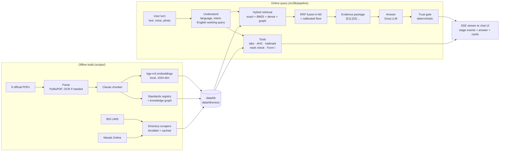

<div align="center">


# BISVEDA

**A conversational assistant for Indian Standards and BIS services. Every factual answer is cited to an official BIS document.**

Smart India Hackathon · Problem Statement **SIH26107**


[What it does](#what-it-does) · [Knowledge it holds](#knowledge-it-holds) · [How it works](#how-it-works) · [Measured quality](#measured-quality) · [Prototype scope](#prototype-scope-read-this) · [Scaling](#how-far-this-scales) · [Run it](#run-it-locally)

</div>

---

Citizens, jewellers and MSMEs ask BIS the same questions every day: which standard covers this product, where can I get it tested, what does 916 mean, how do I register for hallmarking. The answers exist, but they are spread across standards PDFs and separate portals.

BISVEDA answers these questions in plain language, in the user's own language, and **cites the exact clause and page** of the official document. When the documents do not support an answer, it says so and points to the right BIS route instead of guessing.

> [!IMPORTANT]
> This is a **prototype** built for the hackathon demo. It covers 8 Indian Standards and Form I end to end, with real data and real retrieval. It is not a production deployment. [Prototype scope](#prototype-scope-read-this) lists exactly what is real and what is not.

## What it does

| Capability | What the user gets | Where the facts come from |
|---|---|---|
| **Cited Q&A** | Answers about helmets, toys and gold hallmarking, with `[S1]`, `[S2]` pills that open the source excerpt and the PDF at the right page | The 9 employee-uploaded PDFs |
| **Labs finder** | BIS-recognised labs that have a given standard in scope, sorted by distance when location is shared | BIS LIMS directory |
| **Hallmarking centre finder** | Operative AHCs near a city or the user's location, shown on a map | Manak Online AHC directory |
| **Hallmark and ISI mark check** | Purity grade decoding (for example 916 to 22K) and a **format** check of a HUID or CM/L number, plus the BIS Care app / Manak Online route to verify it | IS 1417 clauses plus deterministic format rules |
| **Photo inspection** | Upload a product photo; the assistant reads the category, label text and visible marks | Gemini vision, shown as "what we read from your photo", **never cited as a BIS source** |
| **Form I drafting** | A conversational draft of the 13-field jeweller registration form, with a printable view | The Form I PDF |
| **Multilingual and voice** | Ask in Hindi, Marathi, Hinglish, Tamil and more; speak instead of typing; hear answers read aloud | Language detection, Groq Whisper speech to text, browser read-aloud |
| **Employee console** (`/admin`) | Knowledge graph explorer, document and chunk browser, searchable lab and AHC directories | The same knowledge base the chat uses |

The assistant **never declares a mark, licence or HUID valid or genuine**. It checks the format and sends the user to the official BIS Care app or Manak Online, which are the only places that can confirm it.

## Knowledge it holds

Everything the assistant states comes from two places: `prototype/data/kb` (built from PDFs) and `prototype/data/directory` (scraped from official BIS portals). These numbers are measured from the built files:

| Source | Contents |
|---|---|
| **Standards** | IS 4151 (motorcycle helmets) · IS 2925 (industrial helmets) · IS 9873 Part 1 and Part 3 (toy safety) · IS 15644 (electric toys) · IS 1417 (gold fineness and marking) · IS 1418 (gold fire assay) · IS 15820 (AHC competence) |
| **Forms** | Form I, jeweller registration for hallmarking (13 fields) |
| **Knowledge base** | 9 PDFs → **760 clause-level chunks**, each with a 1024-dim bge-m3 embedding |
| **Knowledge graph** | **320 nodes, 343 edges** (standards, clauses, cross-references, labs, AHC regions) |
| **Testing labs** | **29 labs** from BIS LIMS with at least one of these standards in scope |
| **Hallmarking centres** | **1,651 AHCs** from Manak Online (1,512 operative); 1,490 geocoded, 161 listed without coordinates rather than guessed |

## How it works

BISVEDA is two pipelines: an **offline build** that turns PDFs and portals into a knowledge base, and an **online query pipeline** that answers from it.



### 1. Offline knowledge-base build

`npm run kb:build` (in `prototype/scripts/kb/`) is idempotent and cached, so it is safe to re-run.

1. **Parse.** PyMuPDF extracts text page by page; rapidocr is available for scanned pages. All 9 current PDFs turned out to have real digital text, so 0 pages needed OCR.
2. **Chunk.** A regex clause chunker splits each standard at its clause numbers (`4.2.1`, `Table 1`, and so on), keeping `clause`, `clause_title` and page range on every chunk. That is what makes page-accurate citations possible.
3. **Embed.** Each chunk is embedded locally with **bge-m3** (`Xenova/bge-m3` through transformers.js, 1024 dimensions, multilingual). There is no hosted embedding API, no quota and no placeholder vectors. Embeddings are cached so rebuilds only embed changed chunks.
4. **Registry and graph.** Standards, clauses, cross-references between standards, and the labs and AHC regions linked to them are written to `graph.json`.

The directory scrapers (`prototype/scripts/directory/`) are also cached and polite to the portals:

- **Labs** (`npm run dir:labs`): uses LIMS's reverse lookup by IS number. It needs **one request per standard (7 in total)** instead of crawling every lab page.
- **AHCs** (`npm run dir:ahc`): Manak Online returns the full list in one fetch. Geocoding runs once per unique (district, state) pair through Nominatim. Rows that cannot be geocoded keep no coordinates rather than invented ones.

### 2. Online query pipeline

`POST /api/chat` streams Server-Sent Events. The UI shows a stage ("Understanding your question", "Searching official BIS documents", "Checking the evidence", "Writing a grounded answer") **only when that stage actually runs**.

| Step | File | What it does |
|---|---|---|
| Understand | `pipeline/understand.ts` | Detects language and script, writes an English working query, and classifies intent (question, labs, AHC, hallmark, mark check, Form I, and more) using a fast Groq model with JSON output. Falls back to a deterministic lexicon if the LLM is unavailable. |
| Verified FAQs | `pipeline/speedgate.ts` | Instant answers for a few very common questions. Only entries marked `verified` and rebuilt from real KB chunks are served. |
| Tools | `lib/tools/*` | Labs and AHC lookups (haversine distance, validity filters), hallmark and CM/L format checks, and Form I state machine. These read only the directory files and the KB. |
| Retrieve | `pipeline/retrieve.ts` | Four retrievers run together: **exact** (an IS number in the question pins that standard), **BM25** (k1 1.2, b 0.75), **dense** (cosine over bge-m3 vectors), and **graph** (the standard from earlier turns keeps follow-ups grounded). |
| Fuse and floor | `pipeline/fuse.ts`, `floor.ts` | Reciprocal Rank Fusion (k=60), then a **calibrated similarity floor of 0.67**, computed from the golden set (`npm run calibrate:floor`). Questions below the floor are treated as outside the documents. |
| Package | `pipeline/adjudicate.ts`, `package.ts` | Picks the primary standard and numbers the evidence as `[S1]`, `[S2]`, and so on, each tied to a real chunk, clause and page. |
| Answer | `pipeline/answer.ts` | A Groq-hosted model writes the answer from the package only, citing `[S#]`, and remembers recent turns. If the LLM fails, an evidence-only answer is returned instead. |
| Trust gate | `pipeline/trust.ts` | **Deterministic, and it has the final say.** It strips citations that don't point to a real source. It drops any line that states a number or IS reference not found in the cited text (digits in any script are checked). If nothing supported survives, it refuses and points to the right BIS route. |

Photo input goes through `lib/vision.ts` (Gemini, strict JSON). The result is kept as user-provided evidence: it can trigger a mark check or a follow-up question, but it is never cited as `[S#]`.

## Measured quality

Measured on 2026-09-28 with `npm run eval:rag` and `npm run eval:multi`. These are **small, hand-written test sets**. Read them as regression checks, not as benchmark claims.

| Metric | Result |
|---|---|
| Golden set pass rate (`data/eval/golden.jsonl`) | **29 / 32** |
| Citation validity (every `[S#]` resolves to a real source) | **56 / 56** |
| Number support (every stated figure is in the cited text) | **53 / 53** |
| Wrong standard cited as primary | **0** |
| Multilingual set (Hindi, Marathi, Bengali, Tamil, Telugu, Kannada, Malayalam, Gujarati, English; native and romanised script) | **23 / 24** |

Known misses are kept in the results files, not hidden. For example, one industrial-helmet question retrieves IS 4151 (motorcycle helmets) as primary instead of IS 2925. Per-case results are in `prototype/data/eval/results/`.

## Prototype scope (read this)

> [!WARNING]
> The following parts are **not** production-real. They exist to show intended workflows in the demo.
>
> - **Admin "Document Ingestion" tab and "Version control and amendments" view are UI mockups.** They show seeded sample records and a simulated progress stepper. Uploading there does not change the knowledge base. Real ingestion today is `npm run kb:build` run by a developer.
> - **The phone helpline is not grounded in the knowledge base.** The voice call bridge (`scripts/voice/`, Exotel + Gemini Live) uses a hand-written prompt and does **not** go through retrieval or the trust gate. Without Exotel or Twilio credentials, `/api/helpline/call` runs in a simulated mode. The in-app voice features (speech to text, read-aloud, hands-free chat) **do** use the full cited pipeline.

What else a reviewer should know:

- **Coverage is 8 standards plus Form I.** Anything else is correctly refused. QCO and certification-scheme documents are not in the knowledge base.
- **No database and no user accounts.** Chat history lives in the browser's localStorage. The admin console uses one shared password from `ADMIN_PASSWORD`.
- **Hosted LLMs are on free tiers.** Chat and intent use Groq, and vision uses Gemini. During heavy testing Groq's daily token limit was hit. When that happens, answers degrade to the evidence-only fallback instead of failing, but the output is less fluent.
- **Source PDF quality limits chunk quality.** IS 1417 page 10 has two-column text that interleaves. IS 15644 and some IS 9873 Part 1 pages use a corrupted embedded font, so some clause numbers are unreadable. That content is filed under clause "0" rather than a guessed clause number.
- **Marks, licences and HUIDs are format-checked only**, by design. Real verification belongs to BIS Care and Manak Online.

## How far this scales

We do not claim infinite scale. Here is what the current design can handle, where it stops, and what has to change to go further.

### Today

- One Next.js process loads the whole knowledge base (`chunks.json`, about 22 MB for 760 chunks including vectors) into memory once at startup.
- BM25 and cosine similarity are **brute-force scans** over all chunks. At 760 chunks that is trivially fast.
- bge-m3 query embedding runs **on CPU inside the web process**.
- The API is stateless per request (conversation state is sent by the client), so identical replicas can sit behind a load balancer. Each replica holds its own read-only copy of the knowledge base.

### Ceiling without code changes (our estimate, not benchmarked)

- **About 15,000 chunks, roughly 150 standards of similar length.** Each chunk is about 30 KB of JSON (mostly its embedding), and Node cannot parse a single JSON string much above about 512 MB. That limit arrives first. Brute-force scans and memory per replica also grow linearly before then.
- LLM throughput is capped by the provider tier, not by our code. Each answered question makes one or two LLM calls (intent + answer), plus a translation call for some non-English replies.

### To go further (a known engineering path, not built yet)

| Bottleneck | Change | Effect |
|---|---|---|
| JSON store + linear scans | Move chunks and vectors to **Postgres + pgvector (HNSW index)** with full-text search for BM25. The retrieval interface in `pipeline/retrieve.ts` stays the same. | Millions of chunks. That covers the whole BIS standards catalogue (tens of thousands of standards) on standard vector-database infrastructure. |
| CPU embedding in the web process | Separate, batched embedding service (GPU optional) | Web replicas become light, and embedding scales on its own |
| Free-tier LLM quotas | Paid tier, or self-hosted open models | Throughput limited by budget and hardware, not daily token caps |
| Manual `kb:build` | Wire the admin upload to the real build pipeline, with a job queue | Employees add standards without a developer |
| Browser-only history | Server-side sessions and accounts | Cross-device history and per-user audit |

### Limits that do not go away with more servers

- **Cost and latency per answer** are set by the LLM, not by the retrieval stack.
- **Source quality.** Scanned or badly encoded PDFs still need OCR and human review before they are trustworthy enough to cite.
- **Evaluation has to grow with coverage.** The 0.67 floor was calibrated on 28 questions about 8 standards. Adding standards means adding golden questions and recalibrating, or refusal accuracy will drift.
- **Directories go stale.** Lab scopes and AHC status change, so the scrapers need a schedule, and they should stay polite to the BIS portals.

## Run it locally

### Prerequisites

- Node.js 20+ and npm
- A **Groq API key** (chat, intent, speech to text) and a **Gemini API key** (photo inspection)
- Only for rebuilding the knowledge base: Python 3 with `pymupdf` and `rapidocr_onnxruntime`. The built knowledge base is already committed, so this is optional.

### Start the web app

```bash
cd prototype
npm install
cp .env.example .env   # then fill in GROQ_API_KEY and GEMINI_API_KEY
npm run dev            # http://localhost:3000
```

On first use, the bge-m3 model is downloaded once from the Hugging Face Hub and cached locally.

Optional `.env` settings: `ADMIN_PASSWORD` for `/admin`, and model overrides `GROQ_CHAT_MODEL`, `GROQ_FAST_MODEL`, `GROQ_STT_MODEL`, `GEMINI_VISION_MODEL`, `EMBED_MODEL`. The defaults are `openai/gpt-oss-120b`, `openai/gpt-oss-20b`, `whisper-large-v3` and `Xenova/bge-m3`. Model ids are never hard-wired into the pipeline.

> [!TIP]
> `boot.ps1` / `boot.bat` at the repo root start the web app and the phone voice bridge together. The bridge also needs Python (`fastapi`, `uvicorn`, `pyngrok`, `google-genai`) and Exotel plus ngrok credentials. For a web-only demo, `npm run dev` is enough.

### Scripts (run from `prototype/`)

| Command | Purpose |
|---|---|
| `npm run dev` · `npm run build` · `npm run typecheck` | Develop, build, type-check |
| `npm run kb:build` | Rebuild `data/kb/*` from the PDFs |
| `npm run calibrate:floor` | Recompute the similarity floor from the golden set |
| `npm run dir:labs` · `npm run dir:ahc` | Refresh the lab and AHC directories (throttled, cached) |
| `npm run eval:rag` | Golden-set evaluation |
| `npm run eval:multi` | Multilingual evaluation (`-- --only id1,id2` for specific cases) |

## Demo walkthrough

A 5-minute path through the prototype (full script in [`docs/DEMO.md`](docs/DEMO.md)):

1. **Home page.** The 8 standards covered are listed up front.
2. *"Which standard applies to motorcycle helmets?"* The answer cites IS 4151. Click `[S1]` to see the clause and open the PDF at that page.
3. Follow up with *"what impact test does it need?"* No need to repeat the standard.
4. *"Where can I test my helmet in Mumbai?"* shows real LIMS labs on a map.
5. Upload `prototype/public/samples/helmet_with_isi.jpg` to see what was read from the photo and the CM/L format check.
6. *"Hallmarking centres in Jaipur"* shows operative AHCs from Manak Online.
7. *"What is 916?"* and *"check HUID AB12C3"* show purity decoding and the HUID format check with the BIS Care route.
8. *"I want to register my jewellery shop for hallmarking"* starts the Form I draft and opens the printable view.
9. Ask the same helmet question in Marathi or Hindi. The cited answer comes back in that language.
10. Open `/admin` to explore the knowledge graph, the documents and chunks, and the directories.

## Repository layout

```text
BISVEDA/
├── example docs uploaded by employees/   # the 9 source PDFs + download manifest
├── docs/                                 # DEMO.md, DECISIONS.md, prd.md
├── scripts/                              # boot supervisor, phone voice bridge (Python)
└── prototype/                            # the Next.js app
    ├── data/
    │   ├── kb/                           # chunks, standards, graph, calibration, Form I schema
    │   ├── directory/                    # labs.json (LIMS), ahc.json (Manak Online)
    │   └── eval/                         # golden + multilingual sets, results
    ├── scripts/
    │   ├── kb/                           # parse, chunk, embed, graph, build
    │   └── directory/                    # LIMS and Manak Online scrapers
    └── src/
        ├── app/                          # pages (/, /chat, /admin, /labs, /standards, /form-i/print) + API routes
        ├── components/                   # chat cards, admin console, accessibility
        └── lib/
            ├── pipeline/                 # understand, retrieve, fuse, floor, answer, trust, orchestrator
            ├── tools/                    # labs, ahc, hallmark, form_i
            ├── kb/                       # in-memory store, BM25 + dense search
            ├── voice/                    # speech input, read-aloud
            └── vision.ts                 # photo inspection
```

## Tech stack

**App:** Next.js 15, React 19, TypeScript, Tailwind CSS v4, Leaflet maps, react-force-graph for the knowledge graph.
**AI:** Groq (answers, intent, Whisper speech to text), Gemini (photo inspection only), bge-m3 via transformers.js (local embeddings).
**Offline:** Python + PyMuPDF (PDF parsing), tsx build scripts.
**Data:** JSON files loaded into memory. No database in the prototype, by choice.
