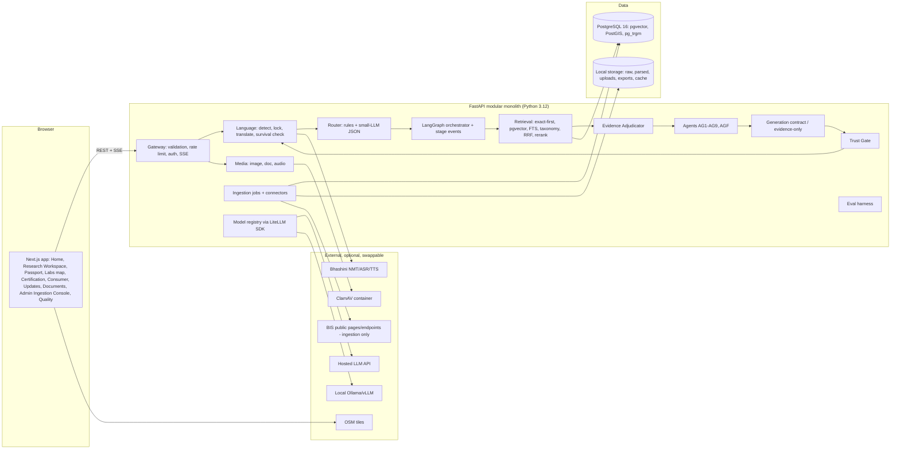

# BISVEDA V8 — Prototype Architecture & Development Plan

**Scope:** The MVP boundary derived from `BISVEDA_Architecture_V8.md`, the prototype architecture, and the implementation plan.
**Status:** PLAN, awaiting team approval. Implementation happens in the agentic IDE (Antigravity), not here.
**Rule of the prototype:** *Same contracts as production, fewer services.* Every simplification sits behind an interface that production replaces without changing callers.

---

## 1. Production vs Prototype Boundary

| V8 component | Prototype | Production | How the prototype keeps the seam |
|---|---|---|---|
| L0 Source registry, tiers A/B, claim policy | **Built** | + Tier C | `knowledge_tier` everywhere from day 1 |
| Connectors (catalogue, labs, AHC, QCO, What's New, schemes, hallmarking, FAQ) | **Built** (scoped groups), snapshot fallback | Scheduled, all groups | Same `Connector` interface + `connector_runs` |
| Self-verifying taxonomy | **Built** | Same | Same invariant file |
| Authenticity: file checks, identity, wrong-document detection | **Built** | + gold diff (Tier C), digital signatures | `AuthenticityCheck` plug-ins |
| Outdated-reference checker | **Built** | Same | — |
| Ingestion pipeline | **Built**: PyMuPDF + Docling, clause/paragraph chunking, bge-m3 embeddings, staging → publish | Temporal, Surya/Paddle OCR cascade, visual analyzer at scale, amendment overlay engine | `Job`/`Step`/`JobEvent` contract; in-process runner |
| Ingestion Console | **Built** (real events over SSE) | Same + Temporal UI links | — |
| Staged router (Stage 1 rules + Stage 2 small-LLM JSON) | **Built** | + Stage 3 distilled classifier | `IntentRouter` interface |
| Multi-Task Planner | **Built** for flagship DAG shapes | General | LangGraph |
| Exact-First, hybrid retrieval (pgvector + FTS + taxonomy), RRF | **Built** | + OpenSearch if needed | `LexicalIndex` interface |
| Cross-encoder reranker | **Built** (CPU, flag to skip) | TEI on GPU | `Reranker` interface |
| Calibrated relevance floor | **Built** + calibration script | Same | stored per engine version |
| Evidence Adjudicator | **Built** (full) | Same | — |
| Orchestrator + 9 agents | **Built**: AG1, AG2, AG4, AG5, AG6, AGF fully; AG3 returns tier notice (no Tier C); AG7 minimal (static records); AG8 simple edition compare; AG9 **stretch** | All | Agent registry |
| Compliance Dossier + export PDF | **Built** | Same | — |
| Generation contract + evidence-only mode | **Built** | Same | — |
| Provider chain via LiteLLM SDK | **Built**: hosted → local (Ollama/vLLM, optional) → evidence-only | LiteLLM proxy + vLLM | `ModelRegistry` config |
| Trust Gate: markers, candidate-set, tier, evidence class, NLI (CPU), PII (regex + Presidio lite), injection heuristics | **Built** | + classifier-based injection detection | `TrustCheck` plug-ins |
| Language: EN + HI full UI; answers translated into TA, BN, MR, TE, GU, KN with marker survival | **Built** (Bhashini if keys, else LLM translation) | Full registry, IndicTrans2 local | `Translator` chain |
| Voice | **Built**: browser Web Speech → server ASR (Bhashini) fallback; TTS in answer language | IndicConformer/IndicTTS local | `ASR`/`TTS` interfaces |
| Image query | **Built**: validation + EXIF strip + pyzbar + vision-role model → candidates | + OCR cascade, ISI heuristic detector | `VisionExtractor` |
| Form I draft | **Stretch** (Scheme-I, 2 product categories) | Full | Template registry |
| Auth | Anonymous public + seeded admin (hashed password, JWT) | Keycloak OIDC | `AuthProvider` |
| Redis, MinIO, Temporal, Keycloak, Vault, Flagsmith, OpenSearch, AGE, Traefik, K8s | **Deferred** (in-process cache, local FS storage, in-process jobs, `.env` secrets, config flags, PG FTS, relational edges + CTE) | Required | Each behind an interface named in §4 |
| WhatsApp, SMS, IVR, partner API | Deferred | Pilot/Production | — |
| Eval harness + Quality page | **Built** (≈ 360 cases) | ≈ 6,300 | Same tables |

---

## 2. MVP Scope — and why it out-scopes the competitors

### 2.1 What the demo must prove (in order)

1. **Flagship MSME question in one turn, in Hindi or English:** *"I make stainless-steel water bottles in Nagpur — which standard, is BIS mandatory, how do I get certified, where can I test?"* → clarification chip → streaming **Compliance Dossier** with applicability classes, QCO status, Scheme-I route (tickable), labs on a map, next actions, evidence ledger → export PDF.
2. **Honesty under pressure:** an out-of-corpus product gets a named-boundary refusal; a numeric question about a metadata-only standard gets a tier notice, not an invented value; gibberish gets a redirect with zero retrieval; a prompt-injection in an uploaded label is ignored and logged.
3. **Evidence you can inspect:** every `[S#]` opens its snippet, locator, tier, class and official link; the Standard Passport shows exactly what is held.
4. **Knowledge ingestion you can watch:** an admin uploads a scheme PDF and the Ingestion Console shows each real step, flags outdated references, and publishes; the answer changes accordingly.
5. **Multilingual that keeps its citations:** the same answer in Tamil or Bengali keeps every `[S#]` and every IS number, or falls back to English with a notice.
6. **Multimodal:** a packaging photo yields candidate product/CM/L entities (clearly labelled candidates) and the verification route; voice input in Hindi works end to end.
7. **Works with no LLM:** flip generation off and the same dossier renders in evidence-only mode.
8. **Measured, not claimed:** the Quality page shows the latest eval run with real numbers.

### 2.2 Competitive position

| Capability | BIS-master (UI reference) | Hackathon-2026 | pramaan | **BISVEDA prototype** |
|---|---|---|---|---|
| Real corpus breadth | ~19–51 standards, 4 docs | 6,209 catalogue + 790 chunks | Mock | Priority-group catalogue (thousands) + public full text |
| Deterministic adjudication before LLM | ✅ | Partial (abstain threshold) | Simulated | ✅ + tier claim policy |
| Knowledge-tier honesty | Partial (text) | ✅ (README policy) | ❌ | ✅ enforced in Trust Gate |
| Citation marker validation | Standard-number check | ✅ | ❌ | ✅ + candidate-set + class checks |
| Multilingual with citation survival | EN/HI measured | Refuses translation on marker loss | Mock | ✅ per-language survival suite |
| Structured multi-section answer | Compliance map | Roadmap page | Simulated journey | ✅ streaming Compliance Dossier + PDF |
| Real progress | Honest single line | — | Fake stepper | ✅ real stage events |
| Ingestion UI | ❌ | ❌ | Simulated | ✅ real job timeline |
| Document review | Cited-IS scoping | Attach & read | ❌ | ✅ + outdated-reference report |
| Image query | ❌ | ❌ (OCR not wired) | ❌ | ✅ candidates + pyzbar |
| Voice | ✅ | ❌ | Simulated | ✅ |
| Lab map | ✅ | List | List | ✅ + PIN distance |
| Evidence-only (no LLM) mode | ✅ | ❌ | n/a | ✅ |
| Form I draft | ❌ | ❌ | ❌ | Stretch |
| Public measured quality page | Badges in README | ❌ | ❌ | ✅ |

### 2.3 Explicitly out of MVP

Tier C full-text standards and gold diffing; amendment overlay engine beyond status/supersession; WhatsApp/SMS/IVR; Keycloak/Temporal/Redis/MinIO/Vault/Flagsmith/OpenSearch/AGE/K8s; air-gapped model pack; Stage-3 classifier; document vault.

---

## 3. Prototype Architecture



Two deployables (`web`, `api`) + PostgreSQL (+ optional ClamAV container) via Docker Compose. Embeddings, reranker and NLI run in-process on CPU (GPU if present) behind interfaces; a `TEI` backend exists for later.

---

## 4. Technology Choices

| Concern | Choice | Why (trace) |
|---|---|---|
| Frontend | Next.js (App Router, current stable), TypeScript strict, Tailwind CSS, Leaflet + react-leaflet | D21; research §6 |
| Backend | FastAPI + Pydantic v2, Python 3.12, `uv` | V7 service choice; Python AI ecosystem (Docling, sentence-transformers) |
| Orchestration | LangGraph | D11; streams node events → stage events |
| LLM access | LiteLLM **SDK** (library, not proxy) | D12 without an extra service |
| DB | PostgreSQL 16 + pgvector + PostGIS + pg_trgm; SQLAlchemy 2 + Alembic; psycopg 3 | D1–D5 |
| Graph | Relational edge tables + recursive CTEs behind `GraphRepository` | D3 seam; AGE later |
| Embeddings | `BAAI/bge-m3` (1024-d) via sentence-transformers / FlagEmbedding | D6 |
| Reranker | `BAAI/bge-reranker-v2-m3` (CPU, top 30, flag-skippable) | D7 |
| NLI | `cross-encoder/nli-deberta-v3-base` (CPU) | D25 |
| Generation (default) | Hosted open-weight model via API (configurable), local Ollama/vLLM optional, evidence-only terminal | §22.2 |
| Vision | Registry vision role (hosted multimodal or local ~9B multimodal); pyzbar; Pillow; python-magic | §16 |
| Parsing | PyMuPDF; Docling for layout/tables; Tesseract (eng+hin) only for scanned pages in prototype | D10 seam |
| Translation | Bhashini (if keys) → LLM translation → English with notice; survival checker | D16, D40 |
| Voice | Web Speech API; Bhashini ASR/TTS server path | D18 |
| PDF export | WeasyPrint + Jinja2 | D22 |
| Malware | ClamAV container (flag; required for admin/user uploads when enabled) | D24 |
| Tests | pytest, httpx, Playwright, @axe-core/playwright, Vitest | §28 |
| Lint/format | ruff, mypy (strict on core packages), eslint, prettier | Engineering principles |

---

## 5. Project Structure

```
bisveda/
├─ apps/web/                      # Next.js Experience Layer
│  ├─ app/(public)/…              # /, /research/[id], /standards, /standards/[id], /compare,
│  │                               # /certification, /testing, /consumer, /updates, /documents, /quality
│  ├─ app/admin/…                 # /admin/ingestion, /admin/connectors, /admin/review, /admin/taxonomy
│  ├─ components/ds/              # design-system primitives (§21.5 of V8)
│  ├─ components/research/        # StageList, DossierSection, EvidenceLedger, WhyPanel, …
│  ├─ lib/api/                    # typed client generated from OpenAPI
│  ├─ lib/sse/                    # stage-event reducer (renders only received stages)
│  ├─ messages/{en,hi}.json       # i18n
│  └─ tests/ (vitest) · e2e/ (playwright + axe)
├─ services/api/
│  ├─ bisveda/
│  │  ├─ config/                  # settings (pydantic-settings), model_registry.yaml, flags.yaml
│  │  ├─ contracts/               # Pydantic models: EvidencePackage, Adjudication, Dossier, StageEvent, JobEvent, SlotSchema
│  │  ├─ gateway/                 # routers, auth, rate limit, SSE
│  │  ├─ language/                # detect, terminology_lock, translate, survival
│  │  ├─ routing/                 # stage1_rules, stage2_llm, gibberish
│  │  ├─ planning/                # planner (DAG shapes)
│  │  ├─ retrieval/               # exact_first, dense, lexical, taxonomy, fusion, rerank, floor
│  │  ├─ adjudication/            # aggregate, coverage, applicability, conflicts, grounding, confidence, claim_policy
│  │  ├─ agents/                  # ag1_standards … ag9_forms, fallback, conflict_skill, eligibility
│  │  ├─ orchestration/           # langgraph graph, stage emitter, dossier builder
│  │  ├─ generation/              # slot prompts, evidence_only renderer
│  │  ├─ trust/                   # markers, candidate_set, tier_policy, evidence_class, nli, pii, injection
│  │  ├─ media/                   # validation, exif, clamav, pyzbar, vision_extractor, asr, tts
│  │  ├─ ingestion/               # jobs (runner), steps (identity, parse, chunk, enrich, embed, outdated_refs, publish)
│  │  ├─ connectors/              # catalogue, labs, ahc, qco, whats_new, schemes, hallmarking, faq; http client (throttle+cache)
│  │  ├─ taxonomy/                # groups.yaml, invariants
│  │  ├─ storage/                 # StorageBackend (local FS), repositories, GraphRepository
│  │  ├─ models/                  # registry, providers (LiteLLM), embedder, reranker, nli
│  │  ├─ exports/                 # dossier PDF, form I PDF (stretch)
│  │  └─ eval/                    # harness, metrics, calibration
│  ├─ migrations/ (alembic)
│  └─ tests/ (unit, contract, integration)
├─ data/
│  ├─ taxonomy/groups.yaml        # product groups ↔ committees ↔ must-contain IS numbers
│  ├─ snapshots/                  # dated connector snapshots (for offline demo)
│  ├─ seed/                       # hand-curated Tier B docs list (URLs + checksums), scheme workflows, eligibility rules, PIN centroids
│  └─ eval/                       # suites (JSONL) per V8 §28.3
├─ infra/docker-compose.yml       # postgres(+pgvector+postgis), api, web, clamav(optional)
├─ docs/                          # V8 architecture, this plan, ADRs, STATUS.md (measured numbers only)
├─ .env.example
└─ Makefile                       # setup, migrate, ingest, calibrate, eval, test, e2e, up
```

Rules: no file > ~400 lines; one responsibility per module; contracts live only in `bisveda/contracts` and are exported to TypeScript via OpenAPI codegen.

---

## 6. Frontend / Backend Approach

- **Backend-for-truth:** every decision (applicability, grounding, QCO, eligibility, tier) is computed in the API and delivered as data. The frontend never infers them.
- **Streaming:** `POST /v1/turns` returns SSE; the web app keeps a reducer keyed by `stage` and `section`, rendering only received events (A16).
- **Server components** for Passport, Standards, Updates, Labs (fast first paint, cacheable); **client components** for the research workspace, map, voice, uploads.
- **Design system first:** primitives from V8 §21.5 built and tested before pages.

## 7. Database & Storage

PostgreSQL schema = V8 §8.2 subset: `sources`, `connectors`, `connector_runs`, `standards`, `documents`, `chunks`, `structured_tables` (empty in MVP), `qco_registry`, `eligibility_rules`, `fee_schedules`, `scheme_workflows`, `labs`, `ahc_centres`, `product_taxonomy`, `synonym_dictionary`, `faq_entries`, `updates`, `users`, `conversations`, `conversation_turns`, `adjudications`, `dossiers`, `feedback`, `ingestion_jobs`, `ingestion_job_events`, `document_authenticity`, `outdated_reference_reports`, `visual_evidence`, `graph_edges` (relational stand-in for AGE), `eval_runs`, `eval_results`, `language_capabilities`. Local filesystem storage under `STORAGE_ROOT` with buckets `raw/`, `parsed/`, `uploads/quarantine/`, `exports/`, `http-cache/`.

## 8. AI / Model Integration

`config/model_registry.yaml` defines roles → ordered providers:

```yaml
roles:
  reasoning: [hosted_primary, local_primary, evidence_only]
  router:    [hosted_fast, local_primary, rules_only]
  vision:    [hosted_vision, local_primary, none]
  translate: [bhashini, hosted_primary, none]
providers:
  hosted_primary: {litellm_model: "${HOSTED_PRIMARY_MODEL}", timeout_s: 20}
  hosted_fast:    {litellm_model: "${HOSTED_FAST_MODEL}",    timeout_s: 6}
  hosted_vision:  {litellm_model: "${HOSTED_VISION_MODEL}",  timeout_s: 20}
  local_primary:  {litellm_model: "ollama/${LOCAL_MODEL}", api_base: "${OLLAMA_BASE_URL}", timeout_s: 60}
policy: {retries_per_provider: 0, cooldown_s: 60}
```

Model names are **environment configuration**, never code. The team picks concrete hosted/local models at build time, verifies they are currently served, and records the choice plus eval results in `docs/STATUS.md`.

## 9. Retrieval Implementation

1. Normalise (NFC, IS-number canonicaliser handling `IS456`, `Is 456 : 2000`, `IS-456(Part 1)`), detect language, lock terms.
2. Stage-1 rules → exact identifiers (SQL on `standards.is_number_norm`) → pinned.
3. Parallel: catalogue dense (`standards.embedding`), chunk dense, chunk FTS (`tsv` weighted), taxonomy/synonym expansion, FAQ dense.
4. RRF (k = 60) → rerank top 30 → top 8.
5. Relevance floor from `calibration.json` (per engine version, produced by `make calibrate` on `refusal-calibration` suite).
6. Adjudicator → Evidence Package v2 (V8 §9.9).

## 10. Knowledge / Document Handling

- **Connectors**: 1 req/s/host, disk cache, snapshot export to `data/snapshots/<connector>/<date>.jsonl`, run report; if live endpoints are unreachable during a demo, `make ingest SNAPSHOT=latest` rebuilds from snapshots. Respect robots/terms; identify the client honestly in the User-Agent.
- **Taxonomy invariants** in `data/taxonomy/groups.yaml`; ingest fails if violated.
- **Tier B documents** listed with URL + expected content type + checksum in `data/seed/tier_b_sources.yaml`; downloads that are HTML redirects instead of PDFs are rejected.
- **Pipeline steps** (each emits `JobEvent`): `upload → malware_scan → identity → catalogue_match → parse → ocr (scanned pages only) → chunk → enrich (tier, tags) → embed → outdated_refs → staging_index → review → publish`.
- **User documents**: same steps up to `outdated_refs`; stored in quarantine; `user_provided` class; never published to the shared index.

## 11. User-Facing Functionality (MVP pages)

| Page | MVP content |
|---|---|
| Home | Search hero (text, mic, image/doc drop), mode switch, popular searches per mode, service cards, What's New rail, corpus-scope statement |
| Research workspace | Three panels; stage list; clarification cards; refinement chips; dossier sections; evidence ledger; research thread; compliance map tabs; recent research; export PDF; feedback |
| Standards & Passport | Search/filter; passport with tier/verification badges, fact grid, QCO block, related standards, "Explain simply" |
| Compare | Two–three standards side by side (catalogue facts + edition/status differences) |
| Certification | 01–05 pathway, wizard bound to Eligibility Engine, scheme explorer |
| Testing & Labs | List/Map toggle, PIN distance, scope/validity filters, AHC layer |
| Consumer | Mark Verifier (shape + official route), image check, complaints, recalls |
| Updates | Weekly feed with filters |
| Documents | Upload → identity → cited IS list → outdated-reference report → research with document |
| Admin | Ingestion Console (live), connectors, review queue, taxonomy invariants view |
| Quality | Latest eval run, gated metrics, known limitations |
| Global | Site-wide assistant widget (separate conversation) |

## 12. APIs (prototype subset of V8 §23.2)

`POST /v1/turns` (SSE) · `POST /v1/turns/{id}/clarify` · `GET /v1/standards` · `GET /v1/standards/{id}` · `GET /v1/standards/{id}/explain` · `GET /v1/compare` · `GET /v1/labs` · `GET /v1/ahcs` · `POST /v1/verify/{cml|crs|huid}` · `GET /v1/updates` · `POST /v1/media` · `POST /v1/documents/{media_id}/review` · `GET/PATCH /v1/dossiers/{id}` · `GET /v1/dossiers/{id}/export.pdf` · `POST /v1/feedback` · `GET /v1/quality` · `GET /v1/health` · admin: `POST /v1/admin/ingest`, `GET /v1/admin/jobs/{id}/events` (SSE), `POST /v1/admin/jobs/{id}/retry`, `GET /v1/admin/connectors`, `POST /v1/admin/connectors/{id}/run`, `GET/POST /v1/admin/review/*`, `POST /v1/auth/login`.

OpenAPI is the single source; TS client generated in CI; contract tests fail on drift.

## 13. Provider Abstraction

Interfaces (Python `Protocol`s) with at least two implementations or a null implementation each: `ChatModel`, `VisionExtractor`, `Embedder`, `Reranker`, `NLIModel`, `Translator`, `ASR`, `TTS`, `LexicalIndex`, `GraphRepository`, `StorageBackend`, `JobRunner`, `AuthProvider`, `MalwareScanner`, `Geocoder`. Selection via config only.

## 14. Security Requirements

- Secrets only in `.env` (never committed); `.env.example` documents every key; startup fails with a clear message if a required key is missing.
- Input validation on every endpoint (Pydantic; size, MIME via magic bytes, page/duration limits); EXIF stripping; ClamAV when enabled (uploads rejected if scanner is enabled and unreachable).
- Admin routes behind JWT auth with hashed passwords (argon2); rate limits per IP on public endpoints.
- Prompt-injection defences: evidence-class wrappers, no tool execution from model text, output checks, injection-pattern logging.
- Logs: structured JSON, no raw uploads, PII redacted, no secrets, trace IDs.
- CORS locked to the web origin; security headers; SSRF guard on connectors (host allowlist).
- Dependency audit + secret-pattern scan in CI.
- No BIS logo/emblem or claims of official status anywhere in the UI.

## 15. Testing Strategy

| Level | What | Tools |
|---|---|---|
| Unit | Normaliser, rules router, gibberish detector, RRF, adjudicator steps, claim policy, marker validator (incl. full-width brackets), survival checker, eligibility rules, outdated-ref checker | pytest |
| Contract | Pydantic ↔ OpenAPI ↔ TS types; SSE event schema; slot schema has no decision fields (test asserts field names) | pytest + schemathesis-style checks, tsc |
| Integration | Retrieval over a small fixture DB; ingestion job end-to-end on fixture PDFs; connectors against recorded HTTP cassettes | pytest + Docker PG |
| Evaluation | V8 §28.3 suites (≈ 360) + floor calibration; results stored; Quality page reads them | `make eval` |
| E2E | Flows A, B, S, T, U, V, W, X, Y, Z | Playwright |
| Accessibility | axe on every page, keyboard traversal of workspace | @axe-core/playwright |
| Responsive/visual | 375/768/1280 snapshots of primitives and key pages | Playwright |
| Chaos-lite | Provider down → evidence-only; embedder down → lexical; translator down → English notice | pytest fault injection |

Definition of done for any feature: tests pass, no fake data presented as real (`demo` badge where fixtures are used), docs/STATUS.md updated with any measured number.

## 16. Development Sequence

| Milestone | Deliverable | Exit criteria |
|---|---|---|
| **M0 Foundations** | Repo, compose, DB migrations, config/registry, contracts package, OpenAPI → TS client, CI (lint, type, test, audit) | `make up` healthy; contract tests green |
| **M1 Data** | Connectors (catalogue for priority groups, labs, AHC, QCO list, What's New, FAQ) + snapshots; taxonomy invariants; Tier B seed docs list | Rows loaded with provenance; invariants pass; run reports stored |
| **M2 Ingestion** | Job runner + steps + events; Ingestion Console backend; outdated-ref checker; identity/wrong-doc checks | Upload → publish visible via SSE; wrong-identity quarantines |
| **M3 Retrieval & Adjudication** | Normaliser, Stage-1 rules, Stage-2 router, exact-first, hybrid, rerank, floor calibration, adjudicator, evidence package | `product-match` and `refusal-calibration` suites produce first Measured numbers |
| **M4 Orchestration & Trust** | LangGraph plan shapes, agents, dossier builder, generation contract, evidence-only, trust checks, language survival, stage events | Flows A, B, S, T, U, V, W pass via API |
| **M5 Experience Layer** | Design system → Home → Research workspace → Passport → Labs → Certification → Consumer → Updates → Documents → Admin → Quality | E2E + axe green on all pages |
| **M6 Multimodal & Voice** | Media handler, pyzbar, vision candidates, image flow, voice in/out | Flows D/E-equivalents + voice pass |
| **M7 Evaluation & Polish** | Full ≈ 360-case run, red-team, Quality page, demo script, snapshot-based offline demo mode | All gated pilot Targets met or honestly reported |
| **M8 Stretch** | Form I draft (Scheme-I, 2 categories) | Draft PDF + crosswalk for fixture companies |

Parallelism: M1 and M5-design-system can start right after M0; M2 and M3 in parallel once M1 has fixtures; M6 after M4's contracts exist.

## 17. Implemented Now vs Deferred

**Now:** everything marked *Built* in §1, the MVP pages in §11, the tests in §15, milestones M0–M7.
**Stretch:** M8 Form I.
**Deferred to production:** Tier C + gold diffing; amendment overlay engine; Temporal, Redis, MinIO, Keycloak, Vault, Flagsmith, OpenSearch, AGE, Traefik, K8s; WhatsApp/SMS/IVR/partner API; local IndicTrans2/IndicConformer/IndicTTS; Surya/Paddle OCR cascade; Stage-3 router; air-gapped kit; document vault; ≈ 6,300-case production eval.

---

## 18. Risks & Mitigations

| Risk | Mitigation |
|---|---|
| BIS endpoints change or throttle | Snapshots + offline demo mode; run reports; trap checks |
| Hosted model availability/quotas | Provider chain + evidence-only; model names in env |
| CPU-only reranker/NLI latency | Top-30 cap, skip flags, cache by (query, doc set) |
| Translation drops markers | Survival check + English fallback; per-language registry downgrade |
| Scope creep | M8 is the only stretch; everything else deferred list is binding |
| Demo network failure | Offline mode: snapshots, local model optional, evidence-only |