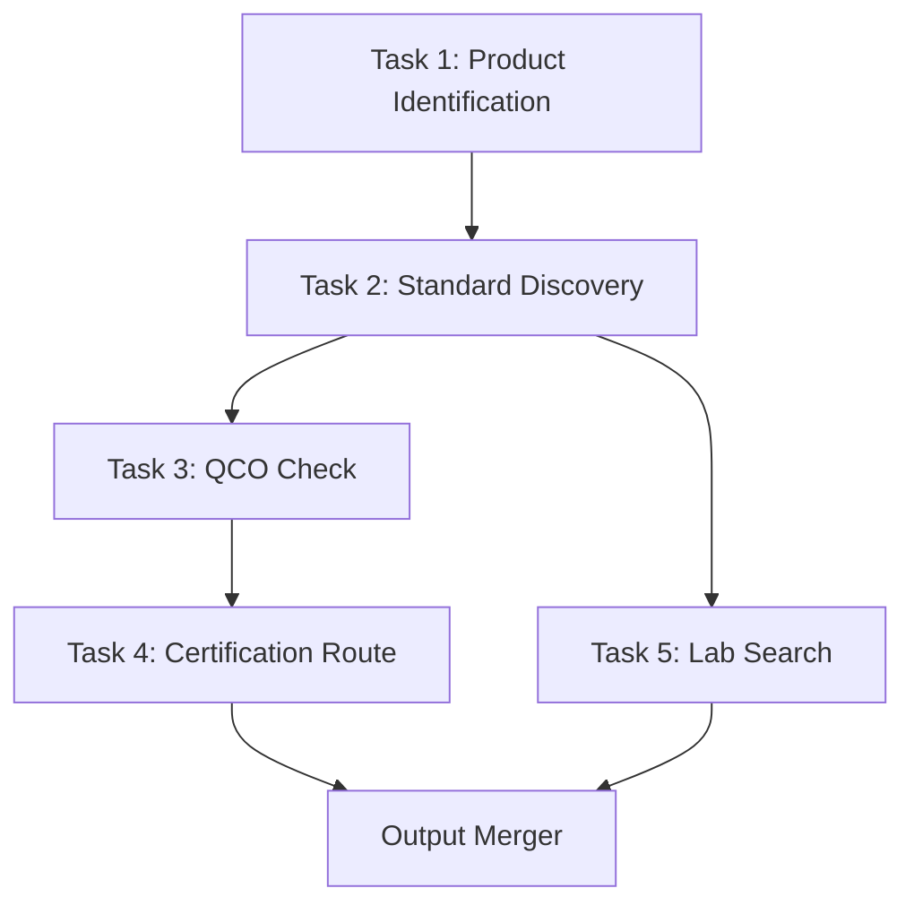
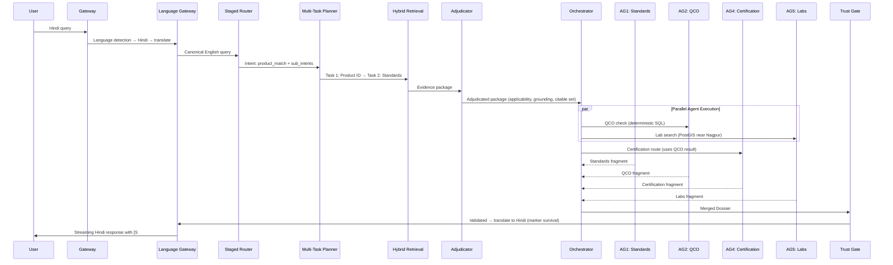

# BISVEDA — Agent Workflow & Orchestration

> **Architecture Reference:** V8 §9–§10
> **Pattern:** Deterministic orchestrator with bounded specialist agents (LangGraph state machine)

---

## 1. Pipeline Overview

```mermaid
graph LR
    INPUT[User Input] --> L1[L1: Gateway]
    L1 --> SG{Speed Gate}
    SG -->|Hit| RESP[Fast Response]
    SG -->|Miss| ROUTE[Staged Router]
    ROUTE -->|Pre-retrieval| PRERETRIEVAL[Smalltalk / Help / Gibberish / Clarification]
    ROUTE -->|Full path| PLAN[Multi-Task Planner]
    PLAN --> RETRIEVE[Hybrid Retrieval]
    RETRIEVE --> RERANK[Cross-Encoder Rerank]
    RERANK --> ADJ[Evidence Adjudicator]
    ADJ --> ORC[Orchestrator]
    ORC --> AGENTS[Specialist Agents]
    AGENTS --> DOSSIER[Compliance Dossier Builder]
    DOSSIER --> GEN{Generation}
    GEN -->|LLM available| CONSTRAINED[Constrained Generation]
    GEN -->|LLM unavailable| EVIDENCE[Evidence-Only Rendering]
    CONSTRAINED --> TRUST[Trust Gate]
    EVIDENCE --> TRUST
    TRUST --> TRANSLATE[Language Gateway]
    TRANSLATE --> OUTPUT[Streamed Response]
```



---

## 2. Staged Intent Router

### Stage 1 — Deterministic Rules (< 50ms)
- **Identifier regexes:** IS codes, CM/L, HUID, QCO IDs → exact lookup
- **Greeting/help lexicon:** Multilingual patterns → static localized reply
- **Gibberish detector:** Character entropy, dictionary hit-rate, script mix → friendly redirect
- **Blocked-topic list:** Out-of-scope obvious → refusal

### Stage 2 — LLM Classifier
- Registry *router* role; temperature 0
- JSON schema output:
```json
{
  "intent": "product_match",
  "sub_intents": ["qco_check", "lab_search"],
  "entities": { "product": "water bottle", "material": "stainless steel" },
  "missing_attributes": ["intended_use"],
  "ambiguity": "needs_clarification",
  "confidence": 0.82
}
```

### Stage 3 — Distilled Classifier (Production only)
- `distilbert-base-multilingual-cased` or successor
- Trained on governed, human-reviewed production traffic
- ≥500 labelled examples per class

### Intent Set (14)
`standard_lookup` · `product_match` · `technical_qa` · `qco_check` · `certification_guidance` · `hallmarking` · `lab_search` · `ahc_search` · `consumer_verification` · `consumer_complaint` · `comparison` · `education_training` · `form_preparation` · `document_review`

### Pre-Retrieval Branches
Intents that **never** enter retrieval: `smalltalk`, `help`, `gibberish`, `out_of_scope`, `needs_clarification`

---

## 3. Multi-Task Planner

For complex business queries, creates a dependency-aware execution DAG:



**Rules:**
| Rule | Behaviour |
|---|---|
| Dependency detection | If Task B needs output from Task A → sequential |
| Parallel execution | Independent tasks run in parallel |
| Shared context | All tasks share resolved product/standard context |
| Task-level evidence | Each task has its own evidence package |
| Task-level failure | If one fails, others continue; failed task gets safe fallback |
| Result merging | Deterministic template merger combines outputs |
| Budget | Max 5 parallel tasks, max 30s wall-clock (Target) |

---

## 4. Evidence Adjudicator (9 Steps)

The Adjudicator is the **core architectural innovation** — it makes all decisions **before** any LLM generates text.

| Step | Function | Output |
|---|---|---|
| 1 | **Aggregation** — groups chunks by standard; weighted top-chunk + top-3 depth; resists chunk-volume bias | `candidates[]` with aggregated score |
| 2 | **Coverage Analysis** — per candidate, which query dimensions are supported: `product`, `material`, `intended_use`, `capacity/rating`, `testing`, `certification`, `identifier` | `coverage{}` per candidate |
| 3 | **Applicability Class** — rule table over coverage + taxonomy + tier | 7 classes (see below) |
| 4 | **Conflict Detection** — multiple editions, superseded, conflicting values, QCO mismatch | `conflicts[]` |
| 5 | **Relevance Floor** — calibrated threshold; below = `out_of_corpus` | Named-boundary refusal |
| 6 | **Grounding State** — `verified` / `supported_inference` / `insufficient_evidence` | Enum |
| 7 | **Confidence Label** — from grounding + coverage + tier + extraction confidence | 4-level label |
| 8 | **Citable Set** — evidence items with `[S#]` ID, class `official_source`, tier, locator | `citable_evidence[]` |
| 9 | **Claim Policy** — per tier: A (identity/why), B (paragraph citations), C (clause/numeric) | `claim_policy{}` |

### Applicability Classes
| Class | Meaning |
|---|---|
| `directly_applicable` | Evidence strongly supports this standard applies |
| `potentially_applicable` | Partial coverage; some attributes unknown |
| `related_standard` | Related but not directly applicable |
| `related_material_mismatch` | Right product category, wrong material |
| `scope_unclear` | Evidence exists but scope can't be determined |
| `insufficient_evidence` | Not enough evidence to classify |
| `not_applicable` | Evidence shows this standard does NOT apply |

---

## 5. Specialist Agents

### Agent Registry

| ID | Agent | Intents Handled | Key Tools | Determinism |
|---|---|---|---|---|
| AG1 | Standards & Clause Intelligence | `standard_lookup`, `product_match` | Catalogue search, chunk search, taxonomy, graph | Retrieval deterministic; prose constrained |
| AG2 | QCO & Regulatory | `qco_check` | QCO registry SQL, graph `:MANDATES` | **Fully deterministic** |
| AG3 | Technical Specifications | `technical_qa` | `structured_tables`, numeric validator | Tier C only; otherwise tier notice |
| AG4 | Certification & Licensing | `certification_guidance`, `hallmarking` | Scheme workflows, Eligibility Engine, fee calculator | Eligibility deterministic |
| AG5 | Lab & Centre Locator | `lab_search`, `ahc_search` | PostGIS distance, lab scope, validity filter | **Fully deterministic** |
| AG6 | Consumer Assistance | `consumer_verification`, `consumer_complaint` | Shape validators, recall lookup, complaint templates | Never declares product genuine |
| AG7 | Education & Training | `education_training` | Clubs, training SQL, BM25 | Deterministic |
| AG8 | Standard Comparison | `comparison` | Graph (amendments/supersession), diff engine | Deterministic diff |
| AG9 | Form Preparation | `form_preparation` | Form templates, schema validator, document extractor | Template-driven (A12) |
| AGF | Fallback | Low confidence / no match | FAQ search, catalogue lookup, official links | Never answers regulatory questions |

### Agent Constraints
- Max 3 agents per query
- Max 2 LLM calls per agent
- 30s total wall-clock budget
- Each agent outputs **structured dossier fragments**, never free prose
- Every fragment lists the `[S#]` IDs it depends on
- Tool access is restricted per agent (policy config)

---

## 6. Compliance Dossier

The orchestrator's **structured output contract** for business and product questions:

| Section | Content | Source |
|---|---|---|
| `interpretation` | Product, material, use, capacity, user type, market — each editable | Router entities + clarifications |
| `standards` | Candidates with applicability class, why, tier badge, status, links | Adjudicator + AG1 |
| `regulatory` | QCO status, enforcement date, order reference | AG2 (SQL) |
| `certification_route` | Scheme, eligibility, ordered steps (tickable), documents, fees, portal links | AG4 + Eligibility Engine |
| `testing` | Tests/parameters (Tier B/C only); otherwise tier notice + official link | AG3 (tier-gated) |
| `labs` | Recognized labs with scope, validity, distance | AG5 (PostGIS) |
| `next_actions` | Concrete checklist | Deterministic templates |
| `evidence_ledger` | All `[S#]` items with class, tier, locator, link | Adjudicator |
| `summary` | 2–5 sentence prose | Constrained generator or evidence-only |
| `trust` | Grounding state, confidence label, caveats | Adjudicator + Trust Gate |

---

## 7. Generation Contract

The LLM receives:
1. The question
2. `citable_evidence` block (each item wrapped with `[S#]`)
3. Non-citable context block (wrapped `<user_provided>` / `<untrusted_extraction>`)
4. Claim policy per candidate
5. **Slot schema** — contains ONLY prose fields (e.g., `summary`, `why[standard_id]`)

**The slot schema has NO fields for:**
- Applicability class
- Grounding state or confidence
- QCO status or eligibility
- IS number lists or citation targets

The model **cannot override** adjudicator decisions.

---

## 8. Evidence-Only Mode

When no generation provider is available (or `GENERATION=none`):

```
Deterministic templates + adjudicated package → same Dossier, same citations, zero model
```

Example output:
> "IS 2347:2017 — Domestic Pressure Cookers. Candidate because product and material match the catalogue record [S1]. Certification under Scheme-I is recorded as mandatory by QCO … [S2]."

This is the **terminal fallback** of the provider chain, replacing V7's unspecified "template responses."

---

## 9. Stage-Event Contract (SSE)

Server-Sent Events, one stream per turn:

| Event | Emitted When |
|---|---|
| `turn.accepted` | Gateway accepted input |
| `stage.started` / `stage.completed` | A pipeline stage actually ran (with duration, counts) |
| `clarification.required` | Plan paused for user input |
| `section.ready` | A Dossier section is complete |
| `answer.delta` | Streaming generation (prose slots only) |
| `trust.result` | Trust Gate finished |
| `turn.completed` | End (with latency, trace_id) |
| `turn.failed` | Unrecoverable failure |

**Rule (A16):** The client renders a stage only after receiving `stage.started`. Stages never animate on a timer.

---

## 10. End-to-End Flow Example: MSME Flagship

Query: *"Steel bottle ka standard, BIS mandatory?, certification kaise, Nagpur ke paas lab?"*


