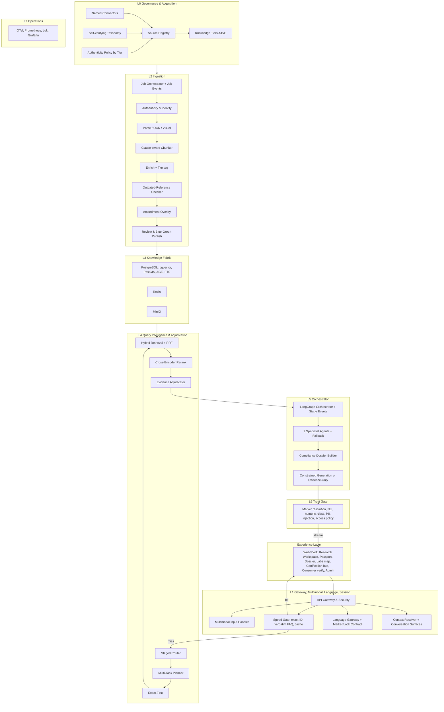

# BISVEDA — Architecture Reference

> **Version:** V8.0 (consolidated from V7 → V8 lineage)
> **System Codename:** BISVEDA (बिसवेदा — BIS + Veda, "Knowledge of Standards")
> **Problem Statement:** SIH26107 · **Team:** fsociety

---

## 1. System Identity

BISVEDA is a **governed, source-backed, multilingual, multimodal AI assistant** for Indian Standards and BIS services. It serves manufacturers, MSMEs, startups, laboratories, consumers, students, government agencies, and BIS staff — across languages, devices, and connectivity conditions.

### 1.1 Core Invariant

```
normalize → route → plan → exact-first → retrieve → rerank → ADJUDICATE
          (deterministic; produces applicability, grounding state, confidence, citable evidence set)
                                         ↓
          generate prose ONLY inside slots, citing ONLY [S#] from the citable set
                                         ↓
          Trust Gate verifies markers, numbers, classes, contradictions
```

If no generation provider is available, the adjudicated package is rendered as an **evidence-only answer**. The pipeline is useful with zero LLM calls.

### 1.2 Design Axioms (A1–A16)

| # | Axiom | Implication |
|---|---|---|
| A1 | Evidence before generation | The LLM is never the source of truth |
| A2 | Never return nothing | Answer, partial answer, clarification, or honest refusal with next steps |
| A3 | Fast by default, deep when needed | Deterministic fast paths first; full pipeline with streaming when required |
| A4 | Validate proportionally | Hard blocks, soft caveats, quality logging |
| A5 | Graceful degradation everywhere | Every dependency has a named fallback |
| A6 | Measurable, not claimed | Target vs Measured convention |
| A7 | Source authority is architecture | L0 governs what enters |
| A8 | Cost-aware routing | Cheapest sufficient path per query |
| A9 | Inclusive by design | Languages, bandwidth, literacy, accessibility |
| A10 | Feedback drives quality | Governed, human-promoted improvements only |
| A11 | Multimodal-safe | OCR/VLM/ASR outputs are candidates with confidence, never proof |
| A12 | Form-safe | Template-driven forms; never claims official submission |
| **A13** | **Adjudicate before you generate** | Decisions computed deterministically from evidence; the model cannot carry them |
| **A14** | **Claim only what your tier holds** | Tier A (catalogue) → recommend; Tier B/C → cite clauses |
| **A15** | **Evidence has a class** | `official_source`, `user_provided`, `ai_interpretation`; only `official_source` is citable |
| **A16** | **Show only real progress** | UI renders only pipeline stages the system actually executed |

---

## 2. Architecture Layers (L0–L7 + XL)

| Layer | Name | Runtime Role | Offline Role |
|---|---|---|---|
| **L0** | Data Governance, Source Authority & Acquisition | — | Registry, tiers, connectors, taxonomy, authenticity policy |
| **L1** | Gateway, Multimodal Input, Language & Session | Entry/exit, multimodal validation, Speed Gate, language, context | — |
| **L2** | Knowledge Ingestion, Authenticity & Visual Intelligence | — | Parse, chunk, enrich, verify, publish |
| **L3** | Knowledge Fabric & Storage | Serves evidence | Receives knowledge |
| **L4** | Query Intelligence, Context, Retrieval & **Adjudication** | Route, plan, retrieve, rerank, **adjudicate** | — |
| **L5** | Orchestrator & Specialist Agents | Execute plan, emit stage events, build Dossier, generate prose | — |
| **L6** | Trust Gate & Guardrails | Validates responses, enforces policy | — |
| **L7** | Operations Platform | Tracing, metrics, caching, model serving | Evaluation, admin, Quality page |
| **XL** | Experience Layer | Web/PWA surfaces, design system, stage-driven rendering | — |

### 2.1 Architecture Diagram



---

## 3. Layer Details

### 3.1 L0 — Data Governance & Acquisition

**Knowledge Tiers** — the foundation of claim honesty:

| Tier | What is Held | What the System May Claim | What It Must Not Do |
|---|---|---|---|
| **A — Catalogue** | Metadata: number, title (EN/HI), committee, year, status, product-group mapping | Recommend, describe, explain applicability | Quote clauses, limits, test values |
| **B — Public Full Text** | Schemes, QCOs, hallmarking regs, FAQs, consumer guidance, lab/AHC directories | Paragraph-level citations into those documents | Present them as the text of an Indian Standard |
| **C — Licensed Full Text** | Indian Standards full text under MOU/licence | Clause/table/numeric answers with `[IS X:YYYY, Cl. a.b]` citations | Serve full text beyond role permission |

**Named Connectors:** `catalogue`, `labs`, `ahc`, `qco`, `whats_new`, `schemes`, `hallmarking`, `faq`, `consumer`, `geocode` — each with 1 req/sec throttle, on-disk cache, SHA-256 provenance, trap handling, and run reports.

**Self-verifying Taxonomy:** Division → Committee → Product Group → Product Type → Variant Attributes. Each product group declares its committees and known-important IS numbers. Ingestion fails if a group's committees don't contain those IS numbers.

### 3.2 L1 — Gateway, Multimodal, Language & Session

| Component | Function | Key Contract |
|---|---|---|
| Speed Gate | Cache, exact-ID, verbatim FAQ, template → bypass LLM | < 200ms for fast path |
| Language Gateway | fastText LID, IndicXlit, Terminology Lock, Bhashini/IndicTrans2 | Marker & Lock Survival Contract |
| Context Resolver | Active entities, anaphora, 1500-token budget, structured rewrite | Schema-validated output, no string concat |
| Multimodal Handler | Image/doc/voice validation, EXIF strip, ClamAV, media_id | Quarantine with 24h TTL |
| Voice Lifecycle | ASR → confidence gate → text pipeline → TTS | Audio purged after transcription |

### 3.3 L2 — Ingestion & Visual Intelligence

Pipeline: `Upload → File Validation → Malware Scan → Identity Extraction → Catalogue Match → [Tier C: Gold Diff] → Parse/OCR → Visual Content → Clause-Aware Chunking → Metadata Enrichment → Outdated-Reference Check → Amendment Overlay → Blue-Green Publish`

Key components:
- **Clause-Aware Chunking:** Standard > Part > Section > Clause > Sub-clause; never split tables; breadcrumbs on every chunk; 256-512 token target
- **Outdated-Reference Checker:** Extracts cited IS numbers → resolves against catalogue/supersession graph → reports: `current`, `older edition`, `withdrawn`, `superseded`, `not in catalogue`
- **Ingestion Console:** Admin surface driven by real job events (SSE), per-step metrics, retry-from-step

### 3.4 L3 — Knowledge Fabric

| Store | Role | Extensions |
|---|---|---|
| PostgreSQL 16+ | Relational core | pgvector (HNSW), PostGIS, Apache AGE, pg_trgm, tsvector |
| Redis 7 | Sessions, rate limits, caches, event fan-out | — |
| MinIO | Raw sources, parsed artifacts, figures, user uploads, generated PDFs | S3-compatible |
| OpenSearch 2.x | BM25 with Indic analyzers | Phase 2+ only |

### 3.5 L4 — Query Intelligence & Adjudication

**Staged Intent Router:**
1. **Stage 1 — Rules:** Identifier regexes, greeting/help, gibberish detector, blocked-topic
2. **Stage 2 — LLM Classifier:** JSON schema output with intent, entities, confidence (14 intents)
3. **Stage 3 — Distilled Classifier:** Production only, ≥500 governed labels/class

**Evidence Adjudicator (9 steps, deterministic, no LLM):**
1. Aggregation (chunk-volume bias resistance)
2. Coverage analysis (7 query dimensions)
3. Applicability class (7 classes)
4. Conflict detection
5. Relevance floor (calibrated, named-boundary refusal)
6. Grounding state (`verified` / `supported_inference` / `insufficient_evidence`)
7. Confidence label
8. Citable evidence set with `[S#]` IDs
9. Claim policy (per-tier)

### 3.6 L5 — Orchestrator & Agents

**9 Specialist Agents + Fallback:**

| ID | Agent | Determinism |
|---|---|---|
| AG1 | Standards & Clause Intelligence | Retrieval deterministic; prose constrained |
| AG2 | QCO & Regulatory | Fully deterministic (SQL) |
| AG3 | Technical Specifications & Numeric Limits | Tier C only; otherwise tier notice |
| AG4 | Certification & Licensing | Eligibility deterministic |
| AG5 | Lab & Centre Locator | Deterministic (PostGIS) |
| AG6 | Consumer Assistance | Never declares a product genuine |
| AG7 | Education & Training | Deterministic |
| AG8 | Standard Comparison | Deterministic diff |
| AG9 | Form Preparation | Template-driven (A12) |
| AGF | Fallback | Never answers regulatory questions |

**Compliance Dossier** — the orchestrator's structured output contract:
`interpretation` → `standards` → `regulatory` → `certification_route` → `testing` → `labs` → `next_actions` → `evidence_ledger` → `summary` → `trust`

### 3.7 L6 — Trust Gate

**Tier 1 — Hard Blocks:** Citation marker resolution, candidate-set check, tier claim policy, NLI contradiction, PII, prompt injection, evidence-class violation, access policy.

**Tier 2 — Caveats:** NLI neutral, stale source, low confidence, superseded source, translation quality, metadata-only notice.

**Tier 3 — Quality Logging:** Completeness, citation density, coverage, stripped-marker counts.

### 3.8 L7 — Operations

- **Observability:** OpenTelemetry → Jaeger/Tempo, Prometheus/Grafana, Loki
- **Model Serving:** vLLM (LLM+VLM), TEI (embeddings+reranker+NLI)
- **LLM Router:** LiteLLM with provider chain
- **Feature Flags:** Flagsmith (self-hosted)
- **Evaluation:** Gated metrics, eval suites, Quality page

### 3.9 XL — Experience Layer

Primary routes: `/` (search-first home), `/research/[id]` (3-panel workspace), `/standards`, `/standards/[id]` (Passport), `/certification`, `/testing`, `/consumer`, `/updates`, `/documents`, `/forms/form-i`, `/admin/*`, `/quality`

---

## 4. Technology Decisions (D1–D52)

| ID | Decision | Choice | Rationale |
|---|---|---|---|
| D1 | Primary Database | PostgreSQL 16 | Unified: relational + pgvector + PostGIS + AGE + FTS |
| D2 | Vector Storage | pgvector | Zero new infra; scales to 10M+ vectors |
| D3 | Graph | Apache AGE | Inside PostgreSQL; amendment/supersession traversal |
| D6 | Embedding | bge-m3 (1024-d) | Best multilingual dense+sparse; open source |
| D7 | Reranker | bge-reranker-v2-m3 | Multilingual cross-encoder; self-hostable |
| D8 | Reasoning LLM | Registry role; default ~9B multimodal | Model currency; one model for text+vision |
| D11 | Orchestration | LangGraph | Deterministic state machine |
| D12 | LLM Router | LiteLLM | Unified API; easy local/cloud switching |
| D35 | Evidence Adjudicator | Before generation | Model cannot override facts |
| D37 | Knowledge Tiers | A/B/C + claim policy | Honest, broad corpus |
| D42 | Evidence-only mode | Terminal fallback | Useful with zero LLM |
| D44 | Stage-Event SSE | Contract | No fake progress (A16) |
| D45 | Compliance Dossier | Output contract | PS flagship flow |

*(Full D1–D52 in V8 architecture §31)*

---

## 5. Deployment Modes

| Mode | GPUs | Generation Chain | External Deps |
|---|---|---|---|
| Demo/SIH | 0-1 | hosted API → local → evidence-only | Hosted LLM, Bhashini |
| Pilot/Cloud | 2×24GB | local vLLM → hosted → evidence-only | Bhashini |
| NIC Government | 3×24GB | local → NIC-approved → evidence-only | Bhashini (NIC) |
| Air-Gapped | 4×24GB | local → evidence-only | None |

---

## 6. Scaling Strategy

| Phase | Scale | Adds |
|---|---|---|
| 0 Prototype | Single machine | Tier A + Tier B, workspace, dossier, adjudicator, evidence-only, eval ≈360 |
| 1 Pilot | 2 GPUs, K8s | Local model serving, Keycloak, Temporal, Redis, MinIO, WhatsApp, voice |
| 2 Production | 3 GPUs, HA | OpenSearch (if needed), full languages, Form I, audit |
| 3 BIS Partnership | + licensed data | Tier C full text, gold diffing, numeric agent |
| 4 Scale & Sovereignty | 4+ GPUs | Air-gapped, Stage-3 router, partner API |
