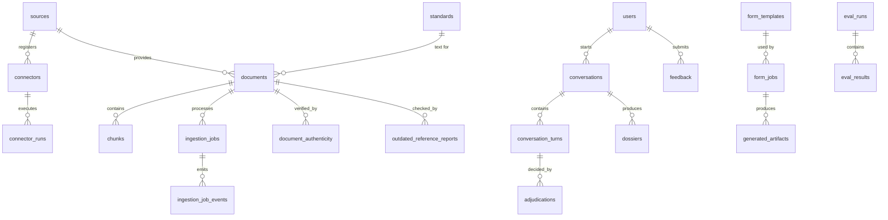

# BISVEDA — Database Schema Reference

> **Architecture Version:** V8.0
> **Primary Store:** PostgreSQL 16+ (pgvector, PostGIS, Apache AGE, pg_trgm, tsvector)
> **Supporting Stores:** Redis 7, MinIO, OpenSearch 2.x (Phase 2+)

---

## 1. Schema Overview



---

## 2. Table Clusters

### Cluster 1: Governance & Acquisition

| Table | Purpose | Engine |
|---|---|---|
| `sources` | Authorized data sources registry | PostgreSQL |
| `connectors` | Named BIS connectors (catalogue, labs, ahc, qco, etc.) | PostgreSQL |
| `connector_runs` | Connector execution history with trap reports | PostgreSQL |

### Cluster 2: Standards Knowledge

| Table | Purpose | Engine |
|---|---|---|
| `standards` | Tier A catalogue (one row per standard, even without text) | PostgreSQL + pgvector |
| `documents` | Full-text documents (Tier B/C) with tier, verification, provenance | PostgreSQL |
| `chunks` | Clause-aware chunks with embeddings, tier, locator, tsvector | pgvector + FTS |
| `structured_tables` | Extracted tables from standards | PostgreSQL |
| `faq_entries` | Official BIS FAQs with embeddings | pgvector |
| `updates` | What's New feed entries | PostgreSQL |

### Cluster 3: Regulatory

| Table | Purpose | Engine |
|---|---|---|
| `qco_registry` | Quality Control Orders (mandatory/voluntary) | PostgreSQL |
| `eligibility_rules` | Deterministic eligibility assessment rules | PostgreSQL |
| `fee_schedules` | Certification fee tables with MSME concessions | PostgreSQL |
| `scheme_workflows` | Step-by-step certification procedures | PostgreSQL |
| `product_recalls` | Product safety alerts and recalls | PostgreSQL |

### Cluster 4: Taxonomy

| Table | Purpose | Engine |
|---|---|---|
| `product_taxonomy` | Division → Committee → Group → Type → Variant | PostgreSQL + AGE |
| `synonym_dictionary` | Colloquial → canonical mappings (sariya → HSD steel bars) | PostgreSQL |

### Cluster 5: Infrastructure (Locators)

| Table | Purpose | Engine |
|---|---|---|
| `labs` | BIS-recognized testing laboratories | PostGIS |
| `ahc_centres` | Assaying & Hallmarking Centres | PostGIS |

### Cluster 6: Ingestion & Trust

| Table | Purpose | Engine |
|---|---|---|
| `ingestion_jobs` | Job status (queued → running → published/failed) | PostgreSQL |
| `ingestion_job_events` | Per-step events with metrics | PostgreSQL |
| `document_authenticity` | Authenticity verification results | PostgreSQL |
| `visual_evidence` | VLM-extracted descriptions from figures/images | PostgreSQL + MinIO |
| `outdated_reference_reports` | Cited-IS freshness analysis | PostgreSQL |

### Cluster 7: Conversation & Decisions

| Table | Purpose | Engine |
|---|---|---|
| `users` | User accounts and profiles | PostgreSQL |
| `conversations` | Chat sessions with surface (research/assistant) and mode | PostgreSQL + Redis |
| `conversation_turns` | Per-turn data (query, intent, evidence, response, trace) | PostgreSQL |
| `adjudications` | Deterministic evidence decisions (persisted for audit) | PostgreSQL |
| `dossiers` | Compliance Dossier payloads with checklist state | PostgreSQL |
| `feedback` | Typed feedback with reason categories | PostgreSQL |

### Cluster 8: Forms

| Table | Purpose | Engine |
|---|---|---|
| `form_templates` | JSON Schema definitions for BIS forms | PostgreSQL |
| `form_jobs` | User form preparation sessions | PostgreSQL |
| `generated_artifacts` | Draft PDFs, checklists | PostgreSQL + MinIO |

### Cluster 9: Quality

| Table | Purpose | Engine |
|---|---|---|
| `eval_runs` | Evaluation suite executions | PostgreSQL |
| `eval_results` | Per-case pass/fail with metrics | PostgreSQL |
| `language_capabilities` | Per-language × capability support matrix | PostgreSQL |

---

## 3. Core DDL

### 3.1 Sources & Connectors

```sql
CREATE TABLE sources (
  id UUID PRIMARY KEY DEFAULT gen_random_uuid(),
  name TEXT NOT NULL,
  owner TEXT NOT NULL,                  -- 'BIS', 'Gazette of India', 'NABL'
  base_url TEXT NOT NULL,
  doc_type VARCHAR(32) NOT NULL,       -- catalogue|scheme|qco|faq|lab_directory|...
  authority VARCHAR(16) NOT NULL
    CHECK (authority IN ('primary','supplementary','deprecated','experimental')),
  knowledge_tier CHAR(1) NOT NULL CHECK (knowledge_tier IN ('A','B','C')),
  licence TEXT NOT NULL,
  update_frequency VARCHAR(32) NOT NULL,
  created_at TIMESTAMPTZ DEFAULT now()
);

CREATE TABLE connectors (
  id VARCHAR(48) PRIMARY KEY,
  source_id UUID NOT NULL REFERENCES sources(id),
  schedule_cron VARCHAR(64) NOT NULL,
  enabled BOOLEAN NOT NULL DEFAULT true,
  last_success_at TIMESTAMPTZ,
  health VARCHAR(16) NOT NULL DEFAULT 'unknown'
    CHECK (health IN ('healthy','degraded','failing','unknown'))
);

CREATE TABLE connector_runs (
  id UUID PRIMARY KEY DEFAULT gen_random_uuid(),
  connector_id VARCHAR(48) NOT NULL REFERENCES connectors(id),
  started_at TIMESTAMPTZ NOT NULL,
  finished_at TIMESTAMPTZ,
  status VARCHAR(16) NOT NULL
    CHECK (status IN ('running','succeeded','failed','partial')),
  rows_added INT DEFAULT 0,
  rows_changed INT DEFAULT 0,
  rows_removed INT DEFAULT 0,
  traps_triggered JSONB DEFAULT '[]',
  error TEXT
);
```

### 3.2 Standards (Tier A Catalogue)

```sql
CREATE TABLE standards (
  id UUID PRIMARY KEY DEFAULT gen_random_uuid(),
  is_number_norm VARCHAR(64) NOT NULL,       -- 'IS 2062:2011' normalised
  is_number_display VARCHAR(64) NOT NULL,
  part VARCHAR(32),
  year INT,
  title_en TEXT NOT NULL,
  title_hi TEXT,                              -- official Hindi title
  committee_code VARCHAR(32),
  committee_name TEXT,
  status VARCHAR(24) NOT NULL
    CHECK (status IN ('current','amended','superseded','withdrawn','unknown')),
  superseded_by UUID REFERENCES standards(id),
  product_group_ids UUID[] DEFAULT '{}',
  max_tier_available CHAR(1) NOT NULL DEFAULT 'A'
    CHECK (max_tier_available IN ('A','B','C')),
  source_url TEXT NOT NULL,
  source_record_sha256 CHAR(64) NOT NULL,
  retrieved_at TIMESTAMPTZ NOT NULL,
  verification_status VARCHAR(16) NOT NULL DEFAULT 'verified'
    CHECK (verification_status IN ('verified','provisional','demo')),
  embedding VECTOR(1024),
  UNIQUE (is_number_norm)
);

CREATE INDEX idx_standards_trgm ON standards USING gin (is_number_norm gin_trgm_ops);
CREATE INDEX idx_standards_emb ON standards USING hnsw (embedding vector_cosine_ops);
```

### 3.3 Documents & Chunks

```sql
CREATE TABLE documents (
  id UUID PRIMARY KEY DEFAULT gen_random_uuid(),
  standard_id UUID REFERENCES standards(id),
  is_number VARCHAR(64),
  title TEXT,
  edition VARCHAR(32),
  year INTEGER,
  amendment_number INTEGER,
  document_type VARCHAR(32) NOT NULL,        -- standard|amendment|qco|gazette|guidance|form_template
  source_authority VARCHAR(32) NOT NULL,
  status VARCHAR(32) NOT NULL,
  effective_date DATE,
  superseded_by UUID REFERENCES documents(id),
  language VARCHAR(8),
  file_checksum VARCHAR(64),                 -- SHA-256
  media_id VARCHAR(128),                     -- MinIO reference
  page_count INTEGER,
  ingestion_status VARCHAR(16),
  knowledge_tier CHAR(1) NOT NULL DEFAULT 'B'
    CHECK (knowledge_tier IN ('A','B','C')),
  verification_status VARCHAR(16) NOT NULL DEFAULT 'provisional'
    CHECK (verification_status IN ('verified','provisional','demo')),
  source_id UUID REFERENCES sources(id),
  source_url TEXT,
  created_at TIMESTAMPTZ DEFAULT now(),
  updated_at TIMESTAMPTZ DEFAULT now()
);

CREATE TABLE chunks (
  id UUID PRIMARY KEY DEFAULT gen_random_uuid(),
  document_id UUID NOT NULL REFERENCES documents(id),
  chunk_index INTEGER,
  content TEXT NOT NULL,
  content_type VARCHAR(32),                  -- clause|table|figure_description|annex|...
  clause_number VARCHAR(32),
  clause_title VARCHAR(128),
  breadcrumb TEXT,                           -- 'IS 456 > §9 Concrete Mix > §9.2 Mix Design'
  page_numbers INTEGER[],
  embedding VECTOR(1024),                    -- bge-m3
  token_count INTEGER,
  language VARCHAR(8),
  amendment_status VARCHAR(16),
  effective_date DATE,
  source_checksum VARCHAR(64),
  product_tags VARCHAR[],
  scheme_tags VARCHAR[],
  cross_references JSONB,
  access_policy VARCHAR(16) DEFAULT 'public',
  knowledge_tier CHAR(1) NOT NULL DEFAULT 'B',
  locator TEXT NOT NULL DEFAULT '',          -- 'Cl. 8.2.4 · Table 5 · p.27'
  tsv TSVECTOR,                             -- weighted: breadcrumb A, heading B, body C
  created_at TIMESTAMPTZ DEFAULT now()
);

CREATE INDEX idx_chunks_emb ON chunks USING hnsw (embedding vector_cosine_ops);
CREATE INDEX idx_chunks_tsv ON chunks USING gin(tsv);
CREATE INDEX idx_chunks_doc ON chunks(document_id);
```

### 3.4 Adjudications & Dossiers

```sql
CREATE TABLE adjudications (
  id UUID PRIMARY KEY DEFAULT gen_random_uuid(),
  turn_id UUID NOT NULL REFERENCES conversation_turns(id) ON DELETE CASCADE,
  relevance_top1 NUMERIC(5,4),
  relevance_floor NUMERIC(5,4) NOT NULL,
  grounding_state VARCHAR(24) NOT NULL
    CHECK (grounding_state IN ('verified','supported_inference','insufficient_evidence')),
  confidence_label VARCHAR(24) NOT NULL
    CHECK (confidence_label IN ('verified_evidence','partially_supported',
                                'limited_evidence','no_verified_evidence')),
  coverage JSONB NOT NULL,
  conflicts JSONB NOT NULL DEFAULT '[]',
  citable_evidence_ids TEXT[] NOT NULL,
  engine_version VARCHAR(32) NOT NULL
);

CREATE TABLE dossiers (
  id UUID PRIMARY KEY DEFAULT gen_random_uuid(),
  conversation_id UUID NOT NULL REFERENCES conversations(id) ON DELETE CASCADE,
  turn_id UUID REFERENCES conversation_turns(id),
  payload JSONB NOT NULL,                    -- Full Compliance Dossier schema
  checklist_state JSONB NOT NULL DEFAULT '{}',
  created_at TIMESTAMPTZ DEFAULT now()
);
```

---

## 4. Apache AGE Graph Relationships

| Relationship | From | To | Properties |
|---|---|---|---|
| `:HAS_CLAUSE` | Standard | Clause | clause_number, title |
| `:MODIFIES` | Amendment | Standard | effective_date, clauses_affected |
| `:SUPERSEDES` | Standard | Standard | effective_date, gazette_notification |
| `:MANDATES` | QCO | Standard | effective_date, product_category |
| `:GOVERNED_BY` | Product | QCO | mandatory, effective_date |
| `:ACCREDITED_FOR` | Lab | Standard | test_scope, validity |
| `:AUTHORIZED_FOR` | AHC | Standard | validity |
| `:REFERENCES` | Standard | Standard | clause, context |
| `:PART_OF` | Standard | Standard | part_number |
| `:MAINTAINS` | Committee | Standard | — |
| `:COVERED_BY` | ProductGroup | Committee | — |

**Prototype fallback:** Same relationships as relational edge tables with recursive CTEs behind one `GraphRepository` interface.

---

## 5. MinIO Bucket Structure

| Bucket | Contents | Access |
|---|---|---|
| `bisveda-documents` | Raw PDFs, ingested sources | Admin |
| `bisveda-artifacts` | Generated PDFs, checklists, exports | User (scoped) |
| `bisveda-quarantine` | User uploads pending scan | System |
| `bisveda-figures` | Extracted figures/diagrams | System |
| `bisveda-eval` | Evaluation artifacts | Admin |
| `bisveda-backups` | Database backups | Admin |

---

## 6. Redis Key Patterns

| Pattern | Purpose | TTL |
|---|---|---|
| `session:{user_id}` | Hot session state | 30 min |
| `cache:query:{hash}` | Speed Gate query cache | 24h (invalidated on refresh) |
| `cache:faq:{hash}` | FAQ embedding cache | 7d |
| `rate:{ip}:{window}` | Rate limit counters | 60s |
| `stage:{turn_id}` | Stage event fan-out | 5 min |
| `lock:{resource}` | Distributed locks | Auto-release |
