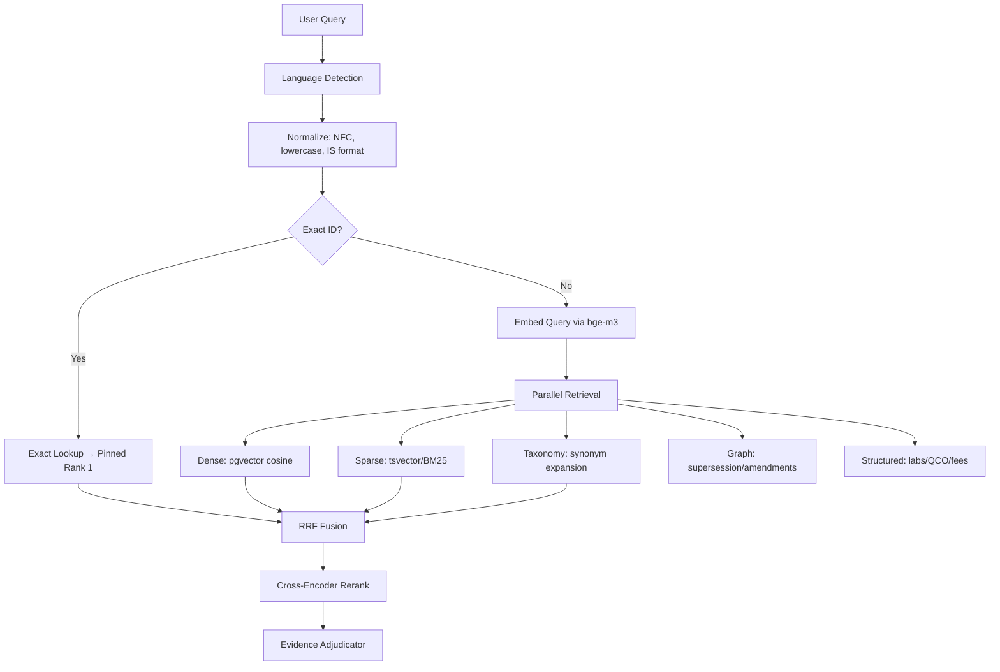

# BISVEDA — RAG Architecture

> **Pattern:** Hybrid RAG with Deterministic Adjudication
> **Architecture Reference:** V8 §9

---

## 1. RAG Philosophy

BISVEDA does **not** use a simple "embed → retrieve → generate" pattern. The RAG strategy is built around a core principle: **decisions are made deterministically from evidence before any model generates text.**

```
┌────────────────────────────────────────────────────────────────┐
│                     Standard RAG                                │
│  Query → Embed → Vector Search → Top-K → LLM → Answer         │
│  (LLM decides relevance, citation accuracy, confidence)        │
└────────────────────────────────────────────────────────────────┘

┌────────────────────────────────────────────────────────────────┐
│                     BISVEDA Hybrid RAG                          │
│  Query → Route → Exact-First → Multi-Signal Retrieve →         │
│  RRF Fuse → Cross-Encoder Rerank → ADJUDICATE                 │
│  (deterministic: applicability, grounding, confidence, citable)│
│  → Constrained Generate (fills prose slots only) →             │
│  Trust Gate (validates citations, classes, tiers)              │
└────────────────────────────────────────────────────────────────┘
```

---

## 2. Retrieval Signals

### 2.1 Signal Types

| Signal | Index | Purpose | Phase |
|---|---|---|---|
| **Exact-First** | `standards.is_number_norm` | IS codes, CM/L, HUID → pinned rank 1 | All |
| **Catalogue Dense** | `standards.embedding` (bge-m3 1024d) | Product → candidate standards (Tier A) | All |
| **Chunk Dense** | `chunks.embedding` (bge-m3 1024d) | Semantic passage retrieval (Tier B/C) | All |
| **Lexical (BM25)** | `chunks.tsv` + `standards` trigram | Exact terminology, IS codes in text | All |
| **Taxonomy** | `product_taxonomy` + `synonym_dictionary` | Deterministic candidate expansion | All |
| **Graph** | Apache AGE / recursive CTEs | Supersession, amendments, QCO mandates, lab scope | All |
| **Structured SQL** | `labs`, `ahc_centres`, `fees`, `workflows`, `qco_registry` | Labs, AHCs, fees, eligibility, recalls | All |
| **FAQ** | `faq_entries.embedding` | Verbatim official answers | All |
| **OpenSearch BM25** | `chunks` index | High-throughput lexical at scale | Phase 2+ |

### 2.2 Exact-First Identifier Policy

For official identifiers, **never** use fuzzy matching as the authority:

```
Normalise Input → Exact Lookup → Match Found?
  → YES: Return validated match (pinned rank 1)
  → NO: Attempt close variants (IS 456 vs IS 456:2000)
    → Still no match? → Ask user for clarification
```

Identifiers with exact-first policy:
- IS numbers (IS 456, IS 1239 Part 1)
- License numbers (CM/L-XXXXXXX)
- HUID codes
- QCO identifiers
- Lab/AHC registration numbers
- Official clause identifiers

Fuzzy matching (pg_trgm, OpenSearch fuzzy) is **only** for natural language product names, spelling mistakes in non-identifier text, and formatting variants ("IS456" → "IS 456").

### 2.3 Embedding Strategy

| Content | Model | Dimensions | Index |
|---|---|---|---|
| Standard titles + scopes | bge-m3 | 1024 | HNSW on `standards.embedding` |
| Document chunks | bge-m3 | 1024 | HNSW on `chunks.embedding` |
| FAQ entries | bge-m3 | 1024 | HNSW on `faq_entries.embedding` |
| User queries | bge-m3 | 1024 | Computed at query time |

**Why bge-m3:**
- Best multilingual dense+sparse model (supports 100+ languages including Hindi)
- 1024-d vectors with cross-lingual retrieval for Indian languages
- Open source (MIT license), self-hostable
- Served via HuggingFace TEI for production

---

## 3. Retrieval Pipeline

### 3.1 Query Processing



### 3.2 RRF Fusion

Reciprocal Rank Fusion (k=60) across dense, lexical, and taxonomy lists:
- Exact-ID results are **pinned** and bypass RRF
- Dense and sparse signals are weighted equally
- Taxonomy matches provide candidate expansion, not ranking

### 3.3 Cross-Encoder Reranking

- Model: `bge-reranker-v2-m3` (567M parameters, ~50ms)
- Input: Top 30 RRF candidates → output: Top 8
- Measures true semantic entailment (not cosine similarity)
- Skipped for exact-ID and structured-only intents
- Budget-controlled: skippable under latency pressure

### 3.4 Relevance Floor

If the top-1 reranked relevance is below a **calibrated** floor:
- The query is flagged `out_of_corpus`
- A fixed, localized refusal **names the corpus boundary**
- The floor is calibrated per release on in-corpus vs out-of-corpus query pairs
- No fixed constant is hard-coded

---

## 4. Knowledge Tiers & Claim Policy

The tier of each evidence piece determines what claims are allowed:

| Tier | What Can Be Claimed | What Is Forbidden |
|---|---|---|
| **A (Catalogue)** | Identity, description, applicability rationale, committee | Clause quotes, numeric limits, test values |
| **B (Public Text)** | Paragraph-level citations into public documents | Presenting them as the text of an Indian Standard |
| **C (Licensed Text)** | Clause/table/numeric answers with full citations | Serving full text beyond role permission |

**Enforcement chain:**
1. Adjudicator tags claim policy per candidate
2. Generation Contract limits prose fields per tier
3. Trust Gate strips claims that violate tier policy
4. UI badges show the tier of each source

---

## 5. Chunking Strategy

### 5.1 Clause-Aware Hierarchical Chunking

```
Standard > Part > Section > Clause > Sub-clause > Table/Figure/Note
```

**Rules:**
- Split at clause boundaries, never mid-paragraph
- **Never split a table** (tables are atomic chunks)
- Each chunk carries a breadcrumb: `IS 456 > §9 Concrete Mix > §9.2 Mix Design`
- Target: 256–512 tokens
- Overlap: 32 tokens, only within a clause
- Parent-child links maintained
- Cross-reference linker captures inter-standard references

### 5.2 Chunk Metadata

Every chunk carries:
- `document_id` → source document
- `clause_number`, `clause_title` → exact location
- `breadcrumb` → hierarchical path
- `page_numbers[]` → physical pages
- `knowledge_tier` → A/B/C
- `locator` → human-readable location string (e.g., "Cl. 8.2.4 · Table 5 · p.27")
- `product_tags[]`, `scheme_tags[]` → domain classification
- `amendment_status` → original/modified/added/deleted
- `access_policy` → public/licensed/restricted

---

## 6. Version & Supersession Resolution

- **Current-by-default:** Always return the latest effective version
- Superseded/withdrawn standards only returned with explicit historical intent
- Amendment overlay chunks preferred over base chunks
- Supersession chain traversal via graph queries
- Automatic warning when retrieving superseded content:
  > "This standard was revised in 2019, superseding the 2009 edition."

---

## 7. Cache Architecture

### 7.1 Speed Gate Cache Layers

| Layer | Key | TTL | Invalidation |
|---|---|---|---|
| Exact cache | `query_hash + language + mode` | 24h | Document ID tagged |
| Semantic cache | `embedding_similarity ≥ threshold` | 24h | Document ID tagged |
| FAQ cache | `faq_entry_id` | 7d | Source refresh |

### 7.2 Embedding Cache

- Embeddings computed at **ingestion time**, not per-query
- Query embeddings computed once and reused across all retrieval signals
- Cached in Redis for repeat identical queries

### 7.3 Cache Invalidation

Every cache entry is tagged with every `document_id` and `standard_id` it cites. On knowledge refresh:
1. Identify affected document/standard IDs
2. Invalidate all cache entries tagged with those IDs
3. Re-embed only changed chunks (diff against checksums)

---

## 8. Evaluation

| Metric | Target (Pilot) | Target (Production) |
|---|---|---|
| Candidate recall@5 (product → standard) | ≥ 0.85 | ≥ 0.92 |
| MRR@10 | ≥ 0.75 | ≥ 0.85 |
| Out-of-corpus refusal precision | ≥ 0.90 | ≥ 0.95 |
| False-standard rate | 0 | 0 |
| Faithfulness (NLI + judge) | ≥ 0.90 | ≥ 0.95 |
