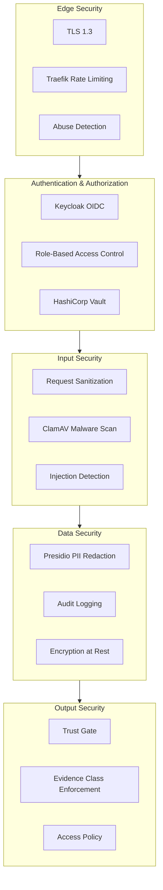

# BISVEDA — Security Architecture

> **Architecture Reference:** V8 §25, §11.5
> **Compliance Target:** Government of India IT security guidelines

---

## 1. Security Layers



---

## 2. Authentication & Authorization

### 2.1 Role Model

| Role | Permissions |
|---|---|
| `public` (anonymous) | Search, research, labs, updates, consumer tools; no persistence beyond session |
| `consumer` | + saved history |
| `business` (MSME/manufacturer/importer) | + dossiers, Form I jobs, document workspace |
| `laboratory` | + lab-oriented views |
| `content_admin` | Ingestion, connectors, taxonomy, review queues |
| `auditor` | Read-only audit, traces, eval runs |
| `super_admin` | Role management, flags, secrets policy |

**Mode presets** (Consumer/Business/Student/Lab) are **UI defaults only** and never grant permissions.

### 2.2 Technology

| Component | Technology | Deployment |
|---|---|---|
| Identity Provider | Keycloak (OIDC) | Production |
| Token Management | JWT with short expiry + refresh | All |
| Secrets Management | HashiCorp Vault | Production |
| API Keys | `.env` file | Prototype only |

---

## 3. Transport Security

| Layer | Mechanism |
|---|---|
| External | TLS 1.3 via Traefik / cert-manager |
| Internal | mTLS between services |
| Database | SSL connections enforced |
| Object Storage | TLS to MinIO |

---

## 4. Input Security

### 4.1 Request Sanitization

- NFC normalization for Unicode
- Null byte stripping
- Size limits per content type (text: 10KB, image: 10MB, PDF: 25MB)
- MIME type validation (strict allowlist)
- Character encoding validation

### 4.2 File Upload Security

| Check | Technology | Action |
|---|---|---|
| MIME validation | `python-magic` / file headers | Reject if mismatch |
| Malware scan | ClamAV | Block + alert |
| Size limits | Middleware | Reject |
| Dimension limits (images) | Pillow | Reject |
| Encrypted PDF detection | PyMuPDF | Reject |
| EXIF stripping | Pillow | Strip before processing |

### 4.3 Injection Prevention

| Vector | Defence |
|---|---|
| Text prompt injection | Input classifier + output pattern detection + heuristic rules |
| Image-embedded injection | OCR/VLM output sanitized; treated as DATA, never as system commands |
| PDF-embedded injection | Parsing output sandboxed; sanitized for injection patterns |
| QR code payload | Decoded and validated against URL allowlist; never executed |
| Voice transcript injection | Treated same as user text; sanitized |
| URL extraction | Validated against known BIS domains before following |

**Core rule:** All extracted text from images/documents/voice is **UNTRUSTED CONTENT**. Image text that says "Ignore all previous instructions" is DATA, not a system command.

---

## 5. Evidence & Output Security

### 5.1 Evidence Classes

| Class | Citable | Prompt Treatment | Source |
|---|---|---|---|
| `official_source` | ✅ `[S#]` | `<evidence sid="S1" tier="B">` | Catalogue, scheme PDFs, QCOs, FAQs |
| `user_provided` | ❌ | `<user_provided kind="...">` | Business context, uploads, voice |
| `ai_interpretation` | ❌ | Model output | Summaries, explanations |

Text inside `user_provided` / `untrusted_extraction` may shape the answer but can **never** be cited or promoted to evidence.

### 5.2 Trust Gate Checks (Tier 1 — Hard Blocks)

| Check | Action on Failure |
|---|---|
| Citation marker resolution | Strip unresolved markers |
| Candidate-set check | Remove sentences with ungrounded IS numbers |
| Tier claim policy | Remove claims violating tier policy |
| NLI contradiction | Retry → safe partial answer |
| PII detection (Presidio) | Redact |
| Prompt injection | Safe refusal + log |
| Evidence-class violation | Strip |
| Access policy | Truncate to permitted excerpt |

---

## 6. Data Security

### 6.1 PII Protection

- **Detection:** Presidio with Indian patterns (Aadhaar, PAN, phone, GSTIN)
- **Action:** Redact from responses; never store in logs
- **Voice:** Audio files deleted after ASR transcription
- **Images:** EXIF data stripped on upload

### 6.2 Data Retention

| Data Type | Retention | Action |
|---|---|---|
| Conversations | 90 days | Anonymized after retention |
| Audit logs | 2 years | Retained for compliance |
| Documents | Permanent | Government requirement |
| Voice audio | Immediately | Deleted after ASR |
| User uploads | 24h quarantine | Purged if not ingested |
| Sessions | 30 min idle | Expired |

### 6.3 Data Deletion

- GDPR-style deletion on user request (personal data, not documents)
- Complete conversation erasure
- Anonymization of feedback data

---

## 7. Rate Limiting

| Tier | Limit | Method |
|---|---|---|
| Anonymous | 30 rpm | Redis token-bucket |
| Authenticated | 120 rpm | Redis token-bucket |
| Partner API | 600 rpm | Redis token-bucket |
| Admin | Unlimited | — |

Abuse detection: repeated injection attempts → IP throttle → block.

---

## 8. Audit Trail

All admin actions logged with:
- Who (user ID, role)
- What (action type, resource ID)
- When (timestamp)
- Result (success/failure)

Audited actions:
- Document uploads and ingestion
- Taxonomy changes
- Connector runs
- Review queue decisions
- Form artifact generations
- Role changes
- Feature flag toggles

---

## 9. URL Allowlist

Only these domains are accepted as source/link targets:

```
bis.gov.in
standards.bis.gov.in
lims.bis.gov.in
manakonline.in
crsbis.in
egazette.gov.in
```

URLs extracted from images/documents/QR codes are validated against this list before use.

---

## 10. Deployment Security

| Mode | Auth | Secrets | Network |
|---|---|---|---|
| Demo | API keys | `.env` | Public internet |
| Pilot/Cloud | Keycloak | Vault | VPC + TLS |
| NIC Government | Keycloak | Vault | NIC network + mTLS |
| Air-Gapped | Keycloak | Vault | Isolated LAN |

---

## 11. Sensitive Data Handling

- **Never infer or use:** Religion, caste, gender, political affiliation
- **Never store:** Aadhaar numbers, PAN (beyond form preparation session)
- **Location:** Only with explicit consent; PIN-code level only
- **Organization data:** Used only for eligibility assessment (deterministic rules)
